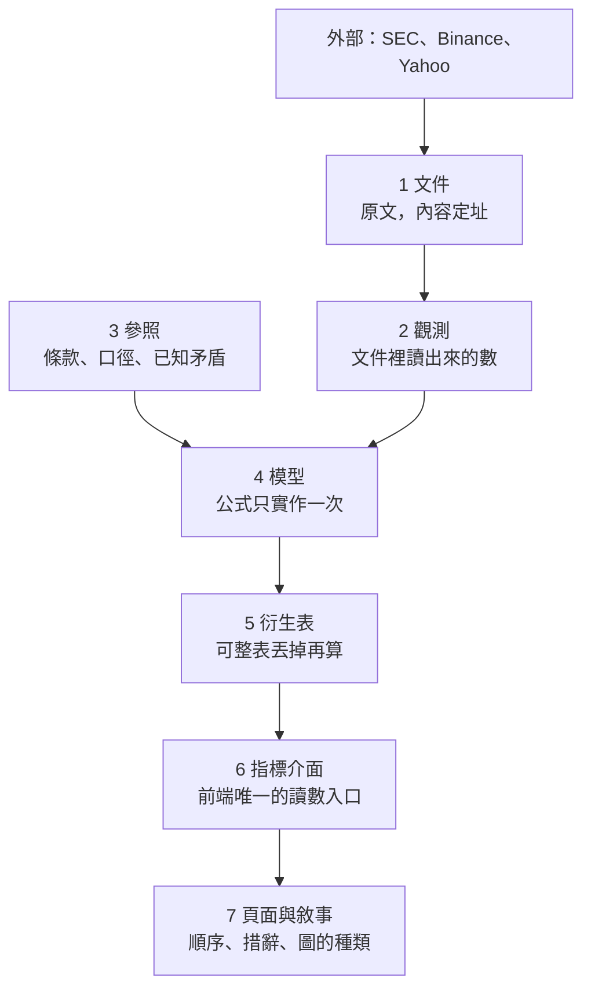
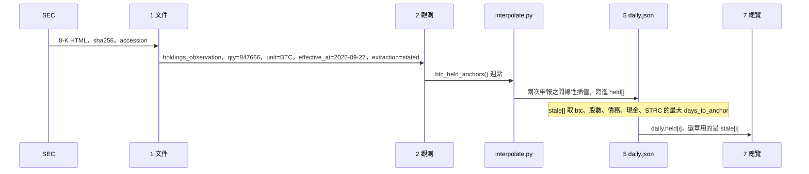

# 架構：研究站的層，與頁面無關

審查日 2026-11-15 的頁面草圖在 [REORG_PLAN.md](REORG_PLAN.md) §3。那一節會過時：公司的故事會變，想先講哪一段也會變。這一頁定的是**換頁不會動到的部分**。

現有程式已經有兩套都叫 L1–L4 的切法，而且 `reference/08-pipeline.md` 開頭自己提醒它們不是同一條軸：

| 名字出現在 | 它切的是 |
|---|---|
| `reference/08-pipeline.md` | 文件 → 事件 → 資本操作 → 階段。往上資訊變少、意義變多 |
| `reference/07-toolbox.md`、`mstr_cebe/toolbox.py` | 量 → 尺 → 工具 → 組合 → 歸因。同一套代數的公式解 |
| `app/src/pages/lecture/` 與 `app/src/pages/board/` | 把上面那套代數排成兩排同名子頁 |

底下這七層是第三種切法：**系統邊界**。它不取代 toolbox 的代數，也不規定導覽。`reference/08` 的「出處往上流、每層可獨立重放、信心往上只減不增」三條，收進第 2 層到第 5 層，不再拿 L1–L4 這個編號稱呼儲存。

---

## 1. 七層

依賴只准往下。頁面碰不到文件，模型碰不到頁面，衍生表不回頭改觀測。

| 層 | 擁有 | 可以依賴 | 現在落在哪 |
|---|---|---|---|
| 1 文件 | 位元組、網址、accession、申報日、抓取日、sha256 | 外部網路，而且只在抓取時 | `mstr_cebe/archive.py` 的 `documents`。檔在 `web/archive.sqlite`，gitignore。`web/archive/manifest.json` 進版控 |
| 2 觀測 | 某一天、某一欄、從哪一格讀出來、是文件明寫還是推得 | 文件的 `doc_id`；參照裡的工具代碼 | `mstr_cebe/events.py` 的 `events`（`family = observation` 與 `action` 已分開）。XBRL 餘額、股數、可轉債合計仍寫死在 `mstr_cebe/data.py` |
| 3 參照 | 條款、順位、面額、票息型態、政策斷點、已知矛盾、釘死的 FWP 快照 | 文件（條款出自哪一份）。不依賴算出來的日頻 | `data.py` 的 `PREFERRED_IPOS`、`SENIORITY_RANK`、`POLICY_BREAKS`、`FINDING_*`、`PARAMS_2026_08_24` |
| 4 模型 | 公式、口徑列舉、工具的代數 | 觀測與參照。不讀 `app/data` | `mstr_cebe/core.py`、`toolbox.py`、`attribution.py`、`scenario.py`。公式解的網頁副本是 `app/data/formulas.json`，由 toolbox 產生 |
| 5 衍生表 | 日頻面板、週視圖、操作配對、階段指標、策略歸因 | 模型的輸出 | `web/build_data.py` → `app/data/*.json`。另外 `mstr_cebe.sqlite` 的 `mnav_readings`、`btc_transactions.cebe_effect` 把衍生值寫進事實庫 |
| 6 指標介面 | 具名指標、單位、截至日、口徑、出處 | 衍生表與指標登錄 | **還沒有。** 頁面直接 `import` `app/src/data.ts` 的寬陣列 |
| 7 頁面 | 路由、句子、圖的幾何、文章 | 指標介面與頁面登錄。不做金融四則運算 | `app/src/main.ts` 的路由表、`app/src/pages/`、`app/src/charts/` |

第 7 層是唯一允許經常改的層。規則在 [SITE_RULES.md](SITE_RULES.md)。表結構在 [DATA_MODEL.md](DATA_MODEL.md)。這一層換頁、換文章時仍要認得是同一個站，那份說明在 [DESIGN_GUIDE.md](DESIGN_GUIDE.md)（顏色、圖、模板、文章怎麼留）。

---

## 2. 一個數怎麼從申報走到像素

以 2026-09-27 的持幣 **847,666** 為例。這是日頻最後一週的 8-K 餘額，也是 `daily.json` 最後一天（2026-10-01）顯示的顆數。

今天實際斷在兩處：

1. **插值發生在觀測離開第 2 層的時候。** `mstr_cebe/interpolate.py` 的 `interpolate_series` 對持幣、債務、現金、股數、優先股股數用同一條直線。持幣的週點被拉成日頻斜線，寫進 `daily.held`。週圖（`weekly.json`，`charts/accumulation.ts`）仍是階梯。同一個量有兩種形狀，頁面沒有欄位可選。
2. **新鮮度在第 5 層被收成一個數。** `web/build_data.py` 把 `days_to_anchor` 取最大值寫進 `daily.stale`。2026-10-01 這個最大值是 93，因為債務的最後 XBRL 錨點是 2026-06-30。總覽把這顆徽章畫在整列讀數上，儀表板的 `staleness()` 把它寫成「距申報 93 天，插值」貼在持幣磚。持幣自己的申報日是 2026-09-27。

目標路徑是：觀測列保持 847,666、`effective_at = 2026-09-27`、`method = step`。日頻面板如果需要每天一列，那一列的 `value` 仍是 847,666，`as_of` 仍是 09-27，`method` 是 `carry`。債務另有自己的 `as_of`。頁面跟指標要這兩個欄位，不再跟一個 `stale` 整數。

### 求償權這條更清楚

模型裡求償權是函式，不是一欄。`mstr_cebe/core.py` 的 `net_senior_claims_usd(cs, basis)` 有四種 `ClaimsBasis`：

| 列舉 | 式子 | 誰在用 |
|---|---|---|
| `CEBETRACKER` | 可轉債面額 + 優先股清算優先權 − 資產負債表現金 | `build_data.py` 寫進 `claims_btc` 的那條；儀表板磚自己又加一次 |
| `COMPANY` | 面額合計，不扣現金 | 總覽探索器 `daily.debt + daily.pref_total`，沒呼叫這個函式 |
| `COMPANY_NET_RESERVE` | 毛額 − USD Reserve | 官方錨點。`PARAMS_2026_08_24["usd_reserve"]` 註解寫明那一格是 Reserve+Cash 的 $6.69B，不是 Reserve |
| `MNAV_COM` | 毛額，漏掉 STRE | 對帳用，不該出現在第一屏 |

2026-10-01 的 `daily.json`：債務 6.67、優先股 14.1059、現金 6.02（單位是十億美元）。`CEBETRACKER` 是 $14.76B。總覽顯示 $20.78B，因為 `app/src/components/explorer.ts` 在瀏覽器裡重算，而且少減了現金。

槓桿也有兩套。`build_data.py` 的 `amp` 是 `1 / (1 − claims_pct)`。`core.amplification` 用的是 FDSO 與 net reserve。定價頁 `app/src/charts/leverage.ts` 的 `latestBasis()` 又用債務 + 優先股 − 現金自己除一次。三處都叫放大，式子不同。指標介面要把它們收成不同的 id，頁面不能再選一個來加。

股價恆等式本身是閉合的。對 `daily.json` 全段 566 天，`P = mnav_cebe × common_btc / shares / 1e8 × btc` 的相對誤差最大約 0.004%。`build_data.py` 的 `_layers4` 另有斷言：四層對數和與 `ln(股價比)` 的差必須小於 `5e-4`。這條守在第 5 層，頁面沒有再守「畫面上的三個數相乘等於畫面上的股價」。

---

## 3. 公式只住一處

金融定義的實作是 `mstr_cebe/core.py` 與 `mstr_cebe/toolbox.py`。

已經守住的一半：推導頁只能 import `app/src/formulas.ts`，而那份 JSON 由 toolbox 產生、裡面沒有觀測。守門是 `tests/test_lecture_is_formula_only.py`。黃金情境是 `tests/test_scenario.py` 對上 `app/test/scenario.test.ts`。

還沒守住的一半：數值解在三個地方各寫了一次。

| 位置 | 它在算什麼 |
|---|---|
| `web/build_data.py` 的 `_chain_increments` | 又寫了一遍 `debt + pref_total − cash`，沒呼叫 `net_senior_claims_usd` |
| `app/src/pages/board/quantities.ts`、`explorer.ts` | 頁面上的求償權 |
| `app/src/charts/leverage.ts` | 滑桿的實得每股、歸零價、放大倍數 |

第 4 層擁有式子。第 5 層只准呼叫。第 6 層把結果連同單位與口徑交出去。第 7 層的圖可以把數值映到像素座標（`lib/scale.ts` 的 `linear`），那不是金融運算。滑桿若要改假設，呼叫同一支函式，並把這次輸入標成 `assumed`。

`CashSource` 與 `ClaimsBasis`、`PriceBasis`、`MNavVariant` 已經是列舉，而且 `core.py` 的註解寫明 USD Reserve 與資產負債表現金不能混。缺的是呼叫端被類型逼著把列舉傳進去，以及頁面只能看見登錄過的組合。

---

## 4. 新鮮度與出處跟著每一個值

一個交出去的值是一個信封，不是一個浮點數。形狀在 [SITE_RULES.md](SITE_RULES.md) 的型別範例。最少這些欄位要能從第 2 層走到第 7 層，中途不被收成最大值：

| 欄位 | 意思 | 持幣這個例子 |
|---|---|---|
| `as_of` | 這個數描述的那一天 | 2026-09-27 |
| `filed_at` | 文件自己寫的申報日 | 該份 8-K 的 `documents.filed_at` |
| `method` | `observed`、`step`、`carry`、`linear`、`spliced`、`reconstructed`、`assumed` | 週點是 `observed`；日頻沿用是 `carry`。現在的日頻斜線是 `linear`，不該再叫成持幣的預設 |
| `sources` | `doc_id` 或 `event_id` | 週表的 `acc` 已經做到 accession；`test_events.py` 會把該份 8-K 重解析，核對那一週真的報了這個數 |
| `basis` | 求償權口徑、股數分母、現金來源 | 持幣沒有。求償權有，而且必須帶著 |

`events.extraction` 已是 `stated | derived`。優先股股數那條還有第三種：`interpolate.py` 用 ATM 的形狀對到季末股數，那是重建，不是文件上的餘額。重建必須帶 `reconstructed`，不能跟 `stated` 用同一種空白。

行情目前沒有進檔案庫。`reference/09-data-gaps.md` 已寫：Binance / Yahoo 的原始回應沒有歸檔。所以股價的 `sources` 今天只能寫到「來源名稱 + 日期」，寫不到 sha256。第 1 層要補的是這份回應本體，不是再做一張價格表。

---

## 5. 建置、測試、部署是一條管線、一個目標

寫下來的更新入口是 `python3 web/refresh.py`。順序與程式一致：SEC 文件 → 事件與 `web/raw` → `mstr_cebe.sqlite` 的市場日線 → 優先股收盤 → 優先股逐週股數 → `app/data`。`--dry-run` 只印各來源最後一天。`LAG_OK` 承認週 8-K 天生比重價慢，門檻因此不同。

測試今天是兩截：

| 指令 | 守什麼 |
|---|---|
| `python3 -m pytest tests/` | 檔案庫、事件、粒度、黃金 FWP、講義沒有觀測、工具代數 |
| `cd app && npm test` 與 `npm run build` | `tsc`、Vitest（目前是情境黃金）、Vite。`npm run build` 已經把測試包進去 |

網站不在執行期讀資料庫。`app/src/data.ts` 把 JSON 靜態打進 bundle。所以「指標介面」是建置產物上的一層型別，不是另一台伺服器。

部署寫了兩個名字：

| 名字 | 怎麼觸發 | 證據 |
|---|---|---|
| `mstr-capital-structure` | `CLAUDE.md` 的手動 `wrangler pages deploy`。倉庫沒有 `wrangler.toml` | 文件如此寫 |
| `master-capital-structure` | GitHub 上的 Cloudflare Workers 建置，push 就跑 | `master` 的 `ddd7b8e`（2026-10-03）成功且有 Version ID。本分支兩次失敗，檢查沒有錯誤本文 |

一條管線的意思是：同一份環境變數指出唯一的專案名；本機最後那行與 git 觸發的建置都讀它；失敗時日誌要能在檢查裡看到。現在兩個名字都算「有部署」，結果寫在不同的地方。選哪一個是之後的決定，這一頁只定「只能有一個」。

`web/archive.sqlite` 不在 git 裡。新的工作區不能只靠版控重放第 1 層。在檔案庫進得了建置之前，CI 做不到「刪掉衍生表再算一次必須逐位元組相同」。做得到的是：已進版控的 `web/raw`、`manifest.json` 與（遷完之後的）觀測 CSV，重算第 5 層之後與 `app/data` 的 diff 必須為空。這條是 [DATA_MODEL.md](DATA_MODEL.md) 的驗收，不是頁面的驗收。

---

## 6. 現在這張圖上，哪些線是斜的

這些是層被穿透的位置，不是頁面好不好看。

| 穿透 | 檔案 |
|---|---|
| 頁面把債務與優先股相加 | `app/src/components/explorer.ts` |
| 頁面再實作一次淨求償權 | `app/src/pages/board/quantities.ts`、`charts/leverage.ts` |
| 建置腳本再寫一次淨求償權 | `web/build_data.py` 的 `_chain_increments` |
| 衍生值寫進事實庫 | `mstr_cebe/db.py` 的 `mnav_readings`；`btc_transactions.cebe_effect` |
| 人手常數與觀測混在一支 Python | `mstr_cebe/data.py`（`XBRL_*`、`SHARE_COUNTS` 是觀測；`PREFERRED_IPOS`、`FINDING_*` 是參照） |
| 兩種現金在插值時接成一條 | `interpolate.py` 的 `_reserve_weekly_cache`：2026-08-30 起把 Reserve 與 Cash 相加，之前只有 Reserve 時改取與 XBRL 的較大值 |
| 新鮮度取最大 | `build_data.py` 的 `stale` |
| 單位在進 JSON 時被縮放 | 金額除以 `1e9`，股數除以 `1e6`。`pref_total` 與五檔面額之和可以差到約 0.0002（十億美元），因為各欄先四捨五入 |
| 路由是程式碼 | `app/src/main.ts` 的 `routes` 陣列。調整順序要改 TypeScript |
| 兩個部署目標 | 上一節 |

---

## 7. 建議的施工順序

頁面重排不在這張表裡。第 7 層在第 6 層存在之後可以隨便改，也不需要先改。

1. **指標登錄與信封型別。** 先加一份登錄（指標 id、單位、口徑、對應的 Python 函式），衍生表仍是現在的 JSON。頁面改為跟 id 要值。這一步不遷 `data.py`。
2. **每個欄位自己的截至日。** 在現有面板上加欄，停止把 `max(days_to_anchor)` 當成持幣的新鮮度。持幣的預設序列改為週點階梯；日頻斜線若還留著，`method` 標 `linear`。
3. **把 `data.py` 裡的觀測表倒成 CSV，讀取端改讀 CSV。** 黃金測試（FWP、恆等式、事件重播）必須與倒出前相同。倒完才刪常數。
4. **Reserve 與 Cash 分成兩列觀測。** 現在那條接起來的序列標 `spliced`，直到呼叫端改指明 `CashSource`。
5. **事實庫不再存放 mNAV。** CLI 改讀第 5 層。`cebe_effect` 移出 `btc_transactions`。
6. **頁面登錄。** 導覽由登錄產生。頁面型別的守門接上現有的 `test_lecture_is_formula_only.py`。
7. **重算即測試。** CI 用已進版控的輸入重跑 `build_data.py`，與 `app/data` 比 diff。
8. **一個部署目標。** 專案名只有一處定義。
9. **之後的任何頁面。** 順序、標題、文章、圖的種類。這一層的改動不該讓第 1 到第 6 層的測試變紅，除非它違反 [SITE_RULES.md](SITE_RULES.md)。
