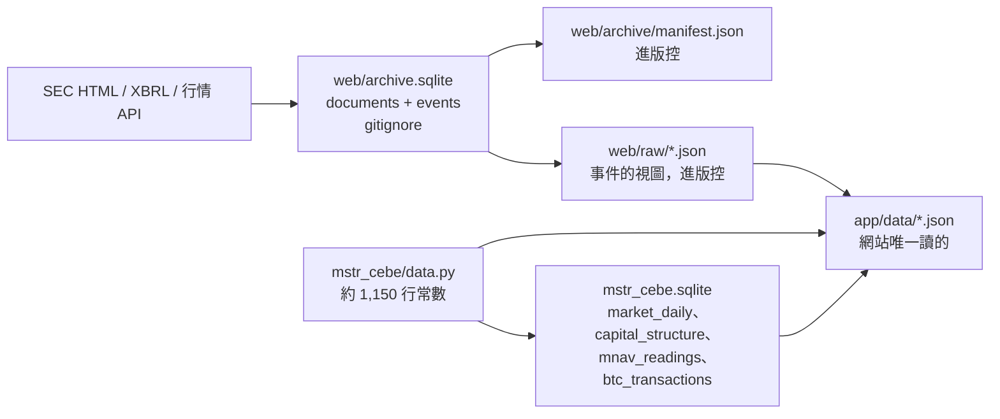
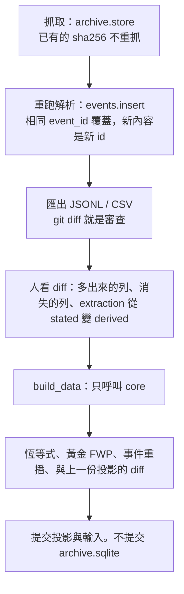

# 資料模型

這一頁把 [REORG_PLAN.md](REORG_PLAN.md) §4 的 CSV 草圖收成可以建表的模型：實體、鍵、單位、缺口怎麼標、一筆新申報怎麼進版、衍生表怎麼重算。儲存建議在第 7 節。現況對照的是 2026-11-15 的 `master`：日頻 2024-07-01 至 2026-10-01（566 天），週頻至 2026-09-27。

層的邊界在 [ARCHITECTURE.md](ARCHITECTURE.md)。頁面怎麼用這些表，在 [SITE_RULES.md](SITE_RULES.md)。

---

## 1. 現在實際有幾份資料



`web/build_data.py` 的 `build_daily()` 同時讀三處：`mstr_cebe.sqlite` 的收盤價、`web/raw/preferred_prices.json`、`interpolate.py` 的錨點。錨點一半來自 `web/raw` 的週檔，一半來自 `data.py` 的 `XBRL_DEBT`、`XBRL_CASH`、`SHARE_COUNTS`。

`mstr_cebe/db.py` 的 `capital_structure` 是另一份時間表，由 `data.capital_structure_timeline()` 灌進去，給 CLI。網站不讀它。同一天的資本結構因此可以有兩份，而且 `mnav_readings` 把算出來的 mNAV 放在這顆事實庫裡。`btc_transactions.cebe_effect` 是解讀，主鍵卻是 `(week_end, funding_source)`，跟買賣事實放在同一列。

`events.py` 已經把該分開的分開了：`family` 是 `action` 或 `observation`，`event_id = hash(doc_id, kind, instrument, locator)`，`extraction` 是 `stated` 或 `derived`，`attrs` 只放文件自己寫的欄位。週檔是這張表的視圖。這張表是第 2 層裡形狀最完整的一份，也是遷移要保留的那份。

`data.py` 裡不該繼續長大的，是觀測與參照寫在同一個模組。`XBRL_DEBT` 是觀測。`PREFERRED_IPOS`、`FINDING_*`、`PARAMS_2026_08_24` 是參照。`PARAMS_2026_08_24["usd_reserve"] = 6.69e9` 的註解寫明：那是 USD Assets（Reserve $5.10B + Cash $1.59B），而且 08-13 那份 FWP 加回的是另一個口徑的 $4.65B，兩份不能套用。欄位名仍叫 `usd_reserve`。

---

## 2. 實體

識別碼用穩定的文字，不用資料庫自增整數。日期用 ISO `YYYY-MM-DD`。金額在這一層是美元或歐元的整數分，不在入庫時除以十億。

### 2.1 `instrument`（參照）

一檔證券或一個餘額科目一行。

| 欄 | 型別 | 說明 |
|---|---|---|
| `instrument_id` | text，主鍵 | 見下表。可轉債一檔一個 id，不併成 `debt` |
| `kind` | enum | `common`、`preferred`、`convertible`、`btc`、`usd_cash`、`usd_reserve` |
| `ticker` | text，可空 | 對外代碼。`STRF`…`STRE`、`MSTR`、`BTC` |
| `currency` | enum | `USD` 或 `EUR`。STRE 是 `EUR` |
| `seniority` | int，可空 | 1 最優先。普通股不排進這個整數，它是殘值 |
| `par` | numeric，可空 | 優先股 stated amount，目前五檔都是 100（本幣） |
| `coupon_kind` | enum，可空 | `fixed`、`floating`、`zero`、`none` |
| `cumulative` | bool，可空 | STRD 為 false |
| `converts_into` | text，可空 | STRK 轉普通股；可轉債轉普通股 |
| `terms_doc_id` | text，可空 | 條款出自哪一份文件 |

現有代碼對得上 `reference/01-architecture.md` 的清償順位與 `events.KINDS`：

| `instrument_id` | kind | 備註 |
|---|---|---|
| `BTC` | btc | 持幣觀測的標的 |
| `MSTR` | common | Class A。10-for-1 分割日記在 `corporate_action`，不寫進價格 |
| `STRF` `STRC` `STRK` `STRD` `STRE` | preferred | STRE 沒有公開報價。`data.py` 的 `SENIORITY_CONFIDENCE["STRE"]` 是 low |
| `USD_CASH` | usd_cash | 資產負債表現金。`CashSource.BALANCE_SHEET` |
| `USD_RESERVE` | usd_reserve | 管理層指定的 USD Reserve。`CashSource.USD_RESERVE`。不是 Cash 的別名 |
| `CONV_*` | convertible | `data.py` 的 `ConvertibleSeries`：名稱、面額、票息、到期年、轉換價、`confidence`。轉換價多數未取得，列上留空，不填 0 |

`convert_issue` 在 `events.KINDS` 裡對到工具 `issue_preferred`。那是工具對應表的現況，不是這張主檔的種類。種類以 `kind` 為準。

### 2.2 `document`（文件）

沿用 `archive.py` 的 `documents`，不另起一張。

| 欄 | 現況 |
|---|---|
| `doc_id` | `sha256(content)` 前 16 碼，主鍵 |
| `source` | `sec_8k`、`sec_xbrl`、`sec_submissions`，以及之後的 `binance`、`yahoo` |
| `url`、`accession`、`filed_at`、`fetched_at`、`media_type`、`sha256`、`byte_len`、`items` | 已有 |
| `content` | zlib 壓縮的原文。解析器只准 `archive.read(doc_id)`，不准自己打網路 |

同一份位元組不會有第二筆。SEC 改檔會得到新的 `doc_id`，舊的留下。

### 2.3 `observation`（觀測）

不要一張大寬表裝所有餘額。共同的信封如下，具體的表只加自己的度量。

| 欄 | 說明 |
|---|---|
| `obs_id` | `hash(doc_id, kind, instrument_id, locator)`。與 `event_id` 同一套冪等 |
| `kind` | 與 `events.kind` 對齊：`holdings_observation`、`reserve_observation`、`btc_purchase`、`btc_sale`、`atm_issue`、… |
| `family` | `observation` 或 `action`。`events.py` 已禁止把餘額當成工具 |
| `instrument_id` | 外鍵 |
| `effective_at` | 這個數描述的日期（週表的 `week_end`、季報的期末、行情的交易日） |
| `period_start`、`period_end` | 流量才有。存量留空。`reference/05-data.md`：存量沒有粒度，不能繼承同一列流量的 `granularity` |
| `filed_at` | 冗餘自文件，讓 diff 不必 join 就能看見 |
| `doc_id`、`locator` | 出處。`locator` 是文件裡的表與列，不是一句「8-K」 |
| `extraction` | `stated`、`derived`、`reconstructed` |
| `granularity` | `instant`、`week`、`quarter`、`year` |
| `confidence` | 0 到 1。`events` 已有這個欄 |
| `unit` | 見第 3 節 |
| `value` | 該單位下的數。未知是 NULL，不是 0 |
| `note` | 人寫的一句，可空 |

分流（都帶上面的信封）：

| 表 | 一行是什麼 | 現在的來源 |
|---|---|---|
| `obs_position` | 時點存量：持幣顆數、各檔優先股股數、基本股數、各可轉債面額、`USD_CASH`、`USD_RESERVE` | 8-K 持幣與 reserve 事件；`data.py` 的 `XBRL_*`、`SHARE_COUNTS`；優先股股數目前是季末對 ATM 形狀的重建 |
| `obs_flow` | 期間流量：買幣、賣幣、ATM、回購。欄位 `qty`、`usd`（流入為正）、`unit_price` | `events` 的 action。週檔 `btc_activity_weekly.json`、`atm_weekly.json` 是視圖 |
| `obs_price` | 收盤，可帶 OHLC。`source` 先是 `binance` 或 `yahoo`，補歸檔後改指 `doc_id` | `market_daily`、`preferred_prices.json`。STRE 全段沒有價，列不存在，不寫 0 |
| `obs_fx` | 貨幣對、匯率、`effective_at` | 今天只有 `interpolate.py` 的 `_FX_EUR = 884_120/775_000`，註解是 2026-06-30 反解。那是一筆 `extraction = reconstructed` 的常數，不是一條日線 |

`obs_position` 的 `measure` 再分辨同一檔證券上的不同數：`btc_held`、`shares_basic`、`shares_fdso`、`shares_assumed_diluted`、`notional`、`liquidation_preference_native`。三個股數分母維持 `core.PriceBasis` 的區分：`GROSS` 用 assumed diluted，`BASIC` 用 basic，網站現在的 `daily.bps` 是 basic。FDSO 覆蓋不完整這件事已記在 `FINDING_FDSO_COVERAGE`，缺的日期留 NULL。

### 2.4 `operation` 與 `phase`（模型之上的兩層意義）

`operation` 是配對，不是新的事實。一筆操作引用數個 `obs_id`（或 `event_id`），帶 `confidence` 與 `extraction`。`mstr_cebe/operations.py` 已依文件敘述配對；`app/data/operations.json` 是 169 筆（155 筆原子 + 14 筆組合）。現金可以替代，配對不能被證明，所以信心度是這張表的必要欄，不是註解。`reference/08-pipeline.md` 把這一層定為第一個不可能證明的層。

`phase` 是編輯過的時期：`phase_id`、起日、迄日、標題。敘事正文不放這裡，放在文章，用指標釘住數字（見網站規則）。`app/data/chronicle.json` 今天把標題與重算過的指標放在同一份 JSON。遷移後標題與起迄留在 `phase`，指標由第 5 層重算。

### 2.5 `finding`（參照，不是事實）

已知矛盾保持一等資料。現有的 `FINDING_2026_07_05_CLAIMS`、`FINDING_CEBE_DENOMINATOR`、`FINDING_SPEC_ARITHMETIC`、`FINDING_THIRD_DENOMINATOR`、`FINDING_FDSO_COVERAGE` 等都在 `data.py`，並被 `db.seed_capital_structure` 寫進 `data_findings`。它們解釋為什麼兩個來源對不上，不參與加總。

FWP 快照（`PARAMS_2026_08_24`、08-13 那份）是釘死的回歸情境，`tests/test_golden_fwp.py` 靠它們。它們進 `scenario` 表：`scenario_id`、`as_of`、各輸入、`doc_id`（`FWP_2026_08_24_ACCESSION`）、`note`。不進「今天」的 `obs_position`。

---

## 3. 單位與口徑

入庫單位與今天 `daily.json` 的單位不同。JSON 是展示用的縮放，而且縮放完再加會漂。

| 量 | 入庫 | 今天的 `daily.json` | 展示 |
|---|---|---|---|
| 法幣 | 該幣別的數值，美元用完整的元 | 除以 `1e9`，欄位名不寫單位 | 頁面格式化成 `$B`，不在頁面上乘回來再加 |
| 比特幣 | 顆 | `held` 是顆；`bps` 是 sats | sats = 顆 × `1e8`，只在格式化時做 |
| 股數 | 股 | `shares` 是百萬股 | 顯示「百萬」是格式 |
| 價格 | 每單位報價貨幣的元 | 已是元 | 元 |
| 比率 | 無因次純數（mNAV、claims_pct、波動率） | 純數 | 標 `basic` 或 `CEBE`，不寫裸的 mNAV |
| 面額 vs 市價 | 清算優先權是 `par × shares`，本幣。市價是 `obs_price` | `strf_lp` 與 `strf_price` 已分開，但 `pref_total` 是面額合計 | 兩套不能相加。求償權的輸入是面額與債務面額 |

`basis` 跟著會受口徑影響的指標，不跟著原始股價：

| 鍵 | 允許的值 | 現有列舉 |
|---|---|---|
| `claims` | `cebetracker`、`company`、`company_net_reserve`、`mnav_com` | `ClaimsBasis` |
| `cash` | `balance_sheet`、`usd_reserve`、`none` | `CashSource` |
| `shares` | `basic`、`fdso`、`assumed_diluted` | `PriceBasis` 的分母那一側 |
| `mnav` | `basic`、`diluted`、`enterprise`、`company`、`cebe` | `MNavVariant` |

網站預設的那一組要寫死在指標登錄，而不是寫在圖的標題裡：求償權 `cebetracker` + `balance_sheet` + 股數 `basic`；basic mNAV 是全部持幣對 basic 股數；CEBE mNAV 是扣完這一組求償權之後。`core.mnav` 已經用這兩個列舉當參數。

### as-of

三個日期不要壓成一個「資料截至」：

| 日期 | 問的問題 |
|---|---|
| `effective_at` | 數描述哪一天 |
| `filed_at` | 公司哪一天這樣說 |
| `built_at` | 這份衍生表何時產生 |

價格日是行情的 `effective_at`。持幣日是持幣那筆的 `effective_at`。兩者可以差一個週末，債務可以差一個季度。頁首若要寫「今天」，那是讀者的日曆，來自時鐘，不來自 `daily.date` 的最後一格。

### step、沿用、插值

| `method` | 意義 | 用在哪 |
|---|---|---|
| `observed` | 這一格就是文件上的數 | 週持幣、季末債務、收盤價 |
| `step` | 只在觀測日改變，觀測日之間保持上一筆 | 持幣的預設日頻。`reference/05-data.md` 已把持幣寫成不插值 |
| `carry` | 最後一筆觀測之後的水平延伸 | 債務在 2026-06-30 之後。這不是插值 |
| `linear` | 兩個錨點之間的直線 | 今天 `interpolate_series` 的預設。債務、股數若仍需要，必須標這個字，而且不是持幣的預設 |
| `spliced` | 兩種定義接成一條 | `cash_anchors()`：XBRL 現金打底，8-K 有 Reserve+Cash 時改相加，只有 Reserve 時取與 XBRL 的較大值 |
| `reconstructed` | 用其他列反推 | 優先股股數對季末；`_FX_EUR`；部分 FDSO |
| `assumed` | 滑桿或情境，不是歷史 | `charts/leverage.ts` 的輸入 |

同一指標可以同時發布 `step` 與 `linear` 兩條，id 不同。頁面預設拿登錄指定的那條。不再發布一個跨欄位的 `stale` 整數。

### 缺口

- 沒有報價：不建列，或 `value` 為 NULL。STRE 的價格是這種。不把面額填進價格。
- 有買賣但資金來源沒寫：`extraction` 仍在，`funding` 空著。週表已有 `stated` / `derived` / 未指名，`reference/05-data.md` §4。推得的來源不能改標成明寫。
- 粒度比分析窗口粗：維持 `events` 的 `resolvable = false` 與 `prorated_usd`。26 天的壓力測試不因攤分產生一個看起來精確的對帳。
- 粒度重疊：維持 `events.resolve_flows()` 的三條（同鍵取最新申報、由細到粗扣掉已解釋的部分、不補出負洞）。年、季、週不得相加。
- 重建與實測衝突：列留下，另寫一筆 `finding`。2025-03-31 持幣曾把申報日餘額標成期末（550,000 對 528,185），那張手工錨點已從 `data.py` 移除。新的手工列必須帶 `doc_id`，否則驗證拒絕入庫。

---

## 4. 衍生表

衍生表的一列是一個指標在一天的值，不是一張越加越寬的寬表。

```text
metric_value(
  metric_id   text,          -- 登錄裡的 id，例如 claims.cebe
  date        text,          -- 面板的那一天
  value       numeric,       -- NULL 代表這一天沒有定義
  unit        text,
  as_of       text,          -- 輸入裡最相關的那筆 effective_at，見登錄
  method      text,
  basis       text,          -- 穩定的 JSON，鍵已排序
  inputs      text,          -- 用到的 obs_id，JSON 陣列
  build_id    text           -- 這次建置的輸入雜湊
)
```

寬的 `daily.json` 可以留下，當作這個長表的發布投影：建置時產生，網站靜態 import。投影的每一欄都要在登錄裡有 `column` 對應，沒有對應的欄位不能進檔。`strategy.json`（約 294KB，整份進 bundle）同樣是投影，輸入改了就整份重算，不手改。

`as_of` 的規則由指標決定，寫在登錄，不由頁面挑：

| 指標 | `as_of` 跟誰 |
|---|---|
| `price.btc`、`price.mstr`、`price.STRC` | 該列行情日 |
| `btc.held` | 最近一筆 `method ∈ {observed, step}` 的持幣 |
| `claims.cebe` | 三個輸入各自的 `as_of` 都要能查到；信封上顯示的那一個是其中最早的，另外兩個在 `inputs` 裡 |
| `mnav.cebe` | 股價日，同時能展開到持幣與求償權的 `as_of` |
| `runway.years` | 分子用最新的 `USD_RESERVE` 與 `USD_CASH`（登錄寫明加總的是哪兩個 id）；分母是 `scenario` 裡仍為常數的年化承諾，並帶那個情境的日期 |

今天的跑道用 `meta.limits`：分子是 2026-08-24 的 $6.69B，標成儲備；分母 `annualObligationsB` 是常數 1.7。那是參照被寫進「最新讀數」的例子。遷完之後，常數留在 `scenario`，讀數留在 `obs_position`。

恆等式是衍生表的斷言，不是頁面的排版：

```text
price.mstr = mnav.cebe × btc_per_share.cebe × price.btc
```

`btc_per_share.cebe` 的單位是顆／股。若展示成 sats，格式化必須可逆（除回 `1e8`），而且斷言用的是入庫值，不是四捨五入後的字串。全表相對誤差維持現在這個量級（最大約 0.004%）以內，否則建置失敗。

---

## 5. 一筆新資料怎麼進來



審查看的是文字 diff，不是 sqlite 的二進位。

| 進來的東西 | diff 裡應該看見 |
|---|---|
| 新的 8-K | `manifest.json` 多一筆；`events` 匯出多了帶該 `doc_id` 的列。持幣若只是沿用，`obs_position` 不該多出一筆假的每日顆數 |
| 新的收盤 | `obs_price` 多幾個交易日。原始回應補進 `document` 之後，diff 裡還有那個 `doc_id` |
| 解析器修正 | 同一批 `doc_id` 下，列的 `value` 或 `extraction` 改變。`reference/05-data.md` 要求這個 diff 剛好等於預期的那幾列 |
| 新的 FWP 錨點 | 新的 `scenario` 列。舊的 08-13 列不動，黃金測試繼續指著它 |
| 人手補的餘額 | 必須有 `doc_id` 與 `locator`。沒有出處的列，驗證直接拒絕 |

`web/refresh.py` 已把順序寫死，並在每步印出覆蓋區間。遷移之後它仍是唯一的寫入入口：它寫第 1、2 層與投影，不寫頁面。

衍生表的重算規則：

1. 刪掉 `app/data` 裡的投影（或寫到暫存目錄）。
2. 只從檔案庫、觀測 CSV、參照 CSV 重跑。
3. 與即將提交的投影做 diff。多出來的欄位、單位變化、某一天的值變化都要出現在這次提交的說明裡。
4. 黃金情境與恆等式不過，投影不能更新。

`mnav_readings` 不再作為這個流程的一站。要查某天的 mNAV，查 `metric_value`。

---

## 6. 版本

| 物件 | 怎麼版本化 |
|---|---|
| 文件 | 內容位址。改一個位元組就是新文件，舊文件還在 |
| 觀測 | `obs_id` 冪等。重解析覆蓋同一 id。文件變了，id 跟著變，舊觀測還指著舊 `doc_id` |
| 參照與情境 | git 歷史就是版本。黃金情境的 id 不回收 |
| 衍生表 | `build_id = hash(輸入檔的 git blob 或 sha256)`，寫進投影的 `meta`。不另做一套衍生表版本號 |
| 指標定義 | 登錄裡的 `definition_rev`。改式子必須改這個修訂號，黃金值的更新因此出現在同一份 diff |

不做「悄悄改歷史」。SEC 改檔留下兩筆 `doc_id`。解析器改錯留下一份事件 diff。

---

## 7. 儲存怎麼選

資料量是百週、幾百筆事件、一條 566 天的面板。`strategy.json` 是目前最大的發布檔，約 294KB。選擇的理由是審查與重算，不是掃描速度。

| 方案 | 判斷 |
|---|---|
| **CSV（或 JSONL）進 git，一實體一檔** | 採用，作為人要看的那一份。一筆新 8-K 是多出來的列。單位與主鍵寫在旁邊的 schema 檔，由驗證器讀，不靠檔名 |
| **SQLite** | 採用，作為第 1 層與第 2 層的工作庫。原文是 blob，外鍵用得上，Python 標準庫就能開。沿用現在的 `web/archive.sqlite`（`documents` + `events`）。這顆檔繼續 gitignore。進 git 的是 `manifest.json` 與事件／觀測的文字匯出 |
| **第二顆 `mstr_cebe.sqlite` 當資本結構的正本** | 停用這個角色。行情在補完原始回應的歸檔之前，可以暫時留在裡面；`capital_structure` 與 `mnav_readings` 不再當正本 |
| **DuckDB / Parquet** | 不採用為正本。二進位 diff 看不出一週持幣改了哪一格。資料量也用不到列式掃描。以後若只是想在本地查詢，可以從 CSV 現建，不進版控 |
| **繼續把觀測寫在 `data.py`** | 停。常數適合黃金情境與列舉，不適合每季追加的 XBRL 列。追加一季在 CSV 是一行，在 Python 是一次容易改錯鄰近常數的編輯 |

一句話：人審查文字表，程式用 SQLite 保管原文與事件，網站只吃建置投影。Parquet 不進這條鏈。

目錄（目標，不是這次就建）：

```text
web/archive.sqlite          工作庫，gitignore，已存在
web/archive/manifest.json   文件清單，已存在
data/ref/instruments.csv
data/ref/findings.jsonl
data/ref/scenarios.csv      FWP 與其他釘死的錨點
data/obs/positions.csv
data/obs/flows.csv
data/obs/prices.csv
data/obs/fx.csv
data/events.jsonl           由 events 表匯出，給 diff
data/operations.csv         配對與信心度
data/phases.csv
data/schema.json            欄位、型別、單位、主鍵、允許的 enum
app/data/*.json             發布投影，建置產生
```

`web/raw/*.json` 在匯出與投影穩定之後降為建置的中間檔，不再被人當正本編輯。`reference/05-data.md` 已經把它們定義成視圖。

### 驗證器要拒絕的列

這些用 `data/schema.json` 加上一支檢查就能擋，不必等頁面：

- 主鍵重複，或 `obs_id` 對不上 `doc_id|kind|instrument|locator`
- `doc_id` 不在 manifest
- `unit` 與 `instrument.kind` 不合（持幣的單位不是 `BTC`，面額的單位不是該檔 `currency`）
- `value = 0` 而 `extraction` 空著，用來冒充「沒有價格」
- `family = observation` 卻填了工具 id
- `USD_RESERVE` 與 `USD_CASH` 相加後寫回其中一欄
- 情境列的 `usd_reserve` 欄位名再度混用 Assets
- 流量的年、季、週三列被某張表加在一起（這條沿用 `resolve_flows` 的測試，不在 CSV 裡預先加總）

---

## 8. 從現況遷過去

每一步都可以停。下一步開始之前，黃金 FWP、恆等式、`tests/test_events.py` 的重播必須仍是綠的。不在同一步改頁面文案。

| 步 | 做什麼 | 怎麼知道沒改數 |
|---|---|---|
| 0 | 寫 `data/schema.json` 與指標登錄，投影仍是現在的 JSON | 現有 pytest 與 `npm test` |
| 1 | 從 `data.py` **倒出** CSV（債務、現金、股數、優先股餘額、IPO 條款、可轉債、finding、FWP）。讀取仍走 `data.py` | 倒出的值與常數逐欄相等的測試 |
| 2 | `interpolate.py` 改讀 CSV。`data.py` 的那些表改成讀 CSV 的薄包裝，避免兩份數字 | `build_daily()` 與現有 `daily.json` 在錨點日一致。持幣的日頻斜線這一步先維持，但標 `method=linear`，避免靜默改歸因 |
| 3 | 持幣的預設發布改為 `step`（週點）。日頻 `linear` 留在另一個 `metric_id`。歸因若因此變，差數單獨成一次提交 | 錨點日的顆數不變。非錨點日的 `held` 允許變，而且 diff 只含這些天 |
| 4 | `obs_position` 把 `USD_CASH` 與 `USD_RESERVE` 分開。現在的接線標 `spliced`，呼叫端改傳 `CashSource` 之後才刪接線 | `CEBETRACKER` 在「接線定義沒變」的日子與舊 `claims_btc` 一致 |
| 5 | 事件匯出 `data/events.jsonl`。`web/raw` 改由這份匯出產生 | `tests/test_events.py` 既有的逐週比對 |
| 6 | CLI 改讀 `metric_value`。停止把 mNAV 寫入 `mstr_cebe.sqlite` | `tests/test_mnav_and_traps.py` 改為對投影斷言，數值不變 |
| 7 | CI：用 CSV + raw 重跑建置，diff 投影 | 乾淨樹上 diff 為空 |

`archive.sqlite` 仍不進 git。第 1 層的離線重放要等檔案庫有一份可取得的副本（或 CI 秘鑰能重建它）。在那之前，第 7 步的輸入是已進版控的匯出，不是「從 HTML 重解析全世界」。

頁面何時改、導覽怎麼排，不在這八步裡。
