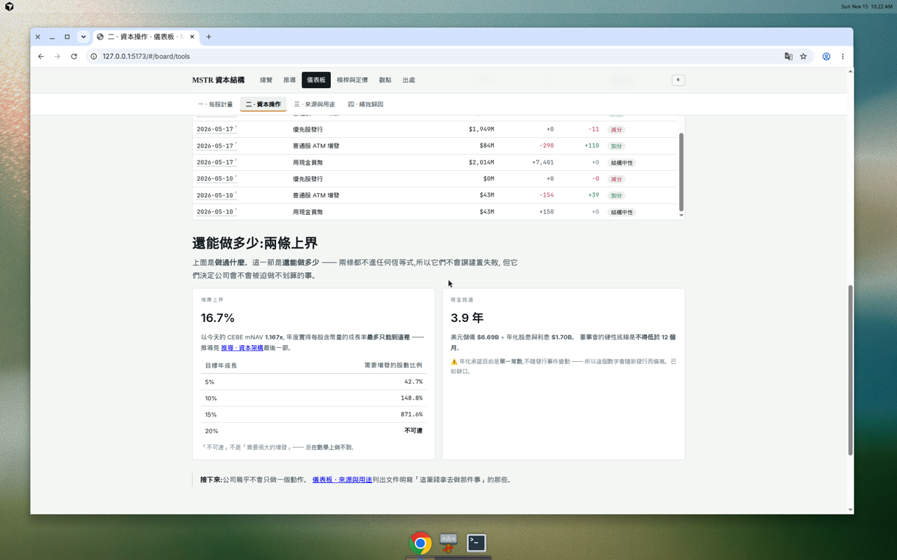
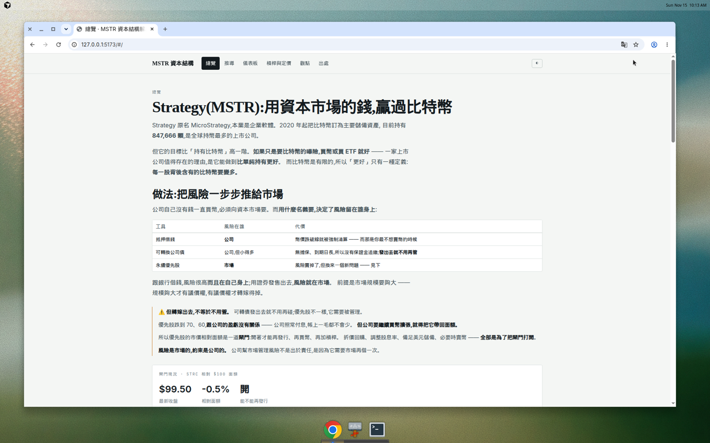
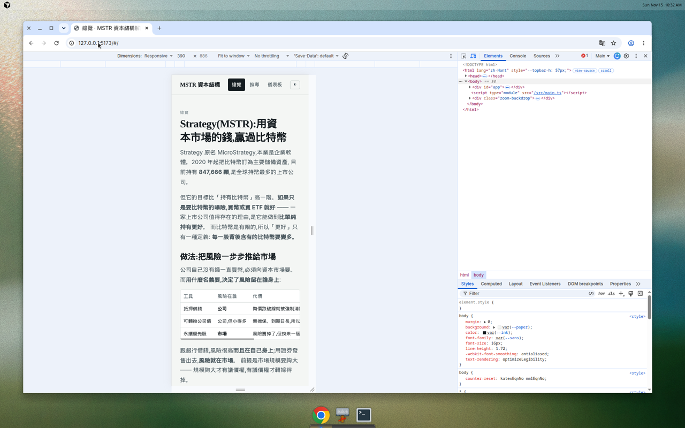

# 重組前審查：呈現、數字、資料層

審查日：2026-11-15。對象是當時 `master` 上的網站與 `app/data`（日頻最後一天 **2026-10-01**，週頻活動最後一週 **2026-09-27**）。本機用 Vite 把站跑起來逐頁看過；下面的截圖是那一次。

這份文件只做三件事：現況怎麼接在一起、讀者現在會看到哪些具體問題、若要重組，呈現與資料各自該長什麼樣、分幾步做。**這次沒有改模型、沒有改頁面。** 前一輪已經把「公式」和「今天的數字」拆開（`reference/11-site.md`、`12-rebuild-plan.md`、`13-exposition.md`）。那個分工留下。還缺的是一條一般讀者走得完的路，以及一份改得動、對得起來的資料。

> **2026-11-15 補充。** §1 與 §2 仍是 `master` 上的事實。§3 的頁面順序是一張草圖：版面與敘事會隨公司的故事、以及想先講哪一段而改，**不是**研究站的契約。階段 0／階段 1 的改頁沒有做。耐久的部分寫在另外三份文件：
>
> - [ARCHITECTURE.md](ARCHITECTURE.md) — 七層邊界、一個數從申報到像素、公式只實作一次、一條管線一個部署目標
> - [DATA_MODEL.md](DATA_MODEL.md) — 實體、鍵、單位、as-of、step 與插值、審查用的 diff、儲存選擇與遷移
> - [SITE_RULES.md](SITE_RULES.md) — 換頁也要守住的規則，以及每一條怎麼讓建置失敗
> - [DESIGN_GUIDE.md](DESIGN_GUIDE.md) — 站的語氣、顏色、圖與文章怎麼留。頁面順序仍可改，這份用來讓改完還是同一個站
>
> 建議的施工順序在 ARCHITECTURE 第 7 節，取代下面第 5 節把改頁放在資料模型前面的排法。

模型本身對得起來。對 `app/data/daily.json` 全段 566 天檢查 `P = m × E / 10^8 × p`，相對誤差最大 0.004%。下面列的問題是**同一個正確的數，在頁面上被加總錯、貼錯標籤、或拿一份過期快照去標成今天**。

---

## 1. 現況架構

### 1.1 讀者看到的頁

單頁應用，hash 路由，沒有前端框架。主導覽六項，推導與儀表板各五個子頁，名稱對齊：

```
總覽
推導          〇 資本架構 · 一 每股計量 · 二 資本操作 · 三 來源與用途 · 四 績效歸因
儀表板        一 每股計量 · 二 資本操作 · 三 來源與用途 · 四 績效歸因
槓桿與定價    （滑桿情境，前端唯一還在做金融計算的頁）
觀點          大事記 · 機制解讀
出處
```

入口實作在 `app/src/main.ts`，各頁在 `app/src/pages/`。圖是手寫 SVG（`app/src/charts/`、`app/src/components/explorer.ts`）。公式排版用 KaTeX。資料以 `import` 靜態打進 bundle（`app/src/data.ts`），瀏覽器不再向 API 要數。

總覽的閱讀順序是一篇論述：這家公司是誰、目的是每股含幣變多、三代融資工具、閘門、波動率表、兩種 mNAV，**然後才是可拖的圖**。推導頁受測試約束，正文不得出現觀測量。儀表板是同一套結構代進今天的數。

### 1.2 數字從哪裡來

網站不連資料庫。讀的是建置時寫好的 JSON：

| 檔案 | 角色 |
|---|---|
| `app/data/daily.json` | 566 天的寬表。價格、持幣、股數、債務、現金、五檔優先股面額與市價、兩種 mNAV、求償權佔比。陣列等長，用索引對齊 |
| `app/data/weekly.json` | 8-K 逐週持幣、買賣、ATM 募資、accession |
| `app/data/operations.json` | 169 筆具名操作（155 筆單一動作 + 14 筆組合） |
| `app/data/strategy.json` | 每個起點各一列的歸因，約 294KB，整份進版控 |
| `app/data/meta.json` | IPO、政策斷點、波動率、閘門、跑道、出處統計、11 則已知資料問題 |
| `app/data/chronicle.json`、`posts.json`、`formulas.json` | 階段敘事、五篇文章、給推導頁的純公式 |

產生它們的指令是 `python3 web/build_data.py`。它自己不做新的金融定義，呼叫 `mstr_cebe.core`。

### 1.3 更下面還有四層存放，而且互相覆蓋

```
SEC 原文
  web/archive.sqlite          L1，內容定址。gitignore，這次工作區裡沒有這顆檔
  web/archive/manifest.json   有進版控：url + sha256，理論上可重抓

解析後的事件
  archive.sqlite 裡的 events  L2。週視圖再寫成 web/raw/*.json（有進版控）

人手整理的資本結構
  mstr_cebe/data.py           約 1,150 行常數：可轉債合計、股數、優先股餘額、
                              票息、FWP 錨點、年化承諾、歐元匯率

市場價格
  mstr_cebe.sqlite            BTC / MSTR 日線，以及舊的 capital_structure、
                              mnav_readings、btc_transactions 表
                              （btc_transactions 還帶一欄 cebe_effect，是解讀不是事實）

網站實際吃的
  app/data/*.json             上面全部插值、合併之後的結果
```

`mstr_cebe/interpolate.py` 是接合點。持幣用 8-K 週點，債務只用 XBRL 季點，現金是「XBRL 季點」蓋上「8-K 的 USD Reserve」，優先股股數是「ATM 形狀對到季末股數」的重建。任一天的值用**線性插值**算出來，錨點之外改成水平延伸。`days_to_anchor` 取幾個欄位的最大值，寫進 `daily.stale`。

另外還有一條舊路：`build_db.py` 把 `data.py` 的時間表灌進 `mstr_cebe.sqlite`，給 CLI（`python3 -m mstr_cebe.cli`）用。README 描述的產品是這條 CLI 和倉庫根目錄的五張 `chart_*.png`。網站不讀那些圖。

`reference/08-pipeline.md` 自己已經指出這顆 sqlite 把算出來的 mNAV、以及 `cebe_effect` 這種解讀，放在事實表旁邊。那一節到現在還在。

### 1.4 怎麼更新、怎麼部署

`python3 web/refresh.py` 是寫下來的唯一入口，順序是：補 SEC 文件 → 重算事件與 `web/raw` → 市場日線 → 優先股收盤 → 優先股逐週股數 → `app/data`。`--dry-run` 只報告各來源落後幾天。

沒有排程。報價的原始回應沒有歸檔（`reference/09-data-gaps.md` 已列）。`web/archive.sqlite` 不進 git，新的工作區無法離線重放。

`CLAUDE.md` 寫的部署是手動的 Pages 專案 `mstr-capital-structure`：

```bash
cd app && npm run build && npx wrangler pages deploy dist \
  --project-name mstr-capital-structure --branch master
```

倉庫裡沒有 `wrangler.toml`。另外，GitHub 上掛著一個**不同名字**的 Cloudflare Workers 建置：`master-capital-structure`。`master` 在 2026-10-03 那次提交（`ddd7b8e`）的這個檢查是成功的，而且回傳了 Version ID。所以「Pages 沒接 git」沒有涵蓋全部：至少有一條 Workers 的 git 建置會在 push 時跑。

這份審查的分支推上去之後，同一個檢查失敗（Build ID `8a2d4b85-befd-42a9-8f8c-868117cd2de2`）。GitHub 上的檢查沒有錯誤本文，也沒有 Version ID；日誌只在 Cloudflare 後台。本機對同一份樹跑 `cd app && npm run build`（`tsc`、4 個 Vitest、Vite）是通過的，所以這顆紅燈不是這次新增的 markdown 讓網站編譯失敗。

之後的決定：上線只走 Pages 專案 `mstr-capital-structure`（`deploy_target.DEPLOY_PROJECT`）。Workers 專案 `master-capital-structure` 不是部署目標，Git 整合要在 Cloudflare 後台關掉。

---

## 2. 具體問題

分三組：同一天兩個數、標籤貼錯欄位、讀者走不進去。截圖在 `docs/audit/`。

### 2.1 總覽的求償權是 $20.78B，儀表板同一天是 $14.76B

2026-10-01，`daily.json` 最後一列：

| 欄位 | 值 |
|---|---|
| 可轉債面額 | $6.67B |
| 優先股清算優先權 | $14.11B |
| 現金 | $6.02B |
| 面額合計，沒扣現金 | **$20.78B** |
| 模型用的淨求償權 `C = D + L − U` | **$14.76B** |

總覽探索器把前兩個相加，標成「求償權合計」（`app/src/components/explorer.ts`）：

```ts
el("r-claims").textContent = bn(daily.debt[i]! + daily.pref_total[i]!);
el("r-amp").textContent = mult(daily.amp[i]);
```

儀表板「每股計量」用的是扣完現金的 $14.76B，副標還寫出三項。槓桿倍數 1.26x 是用淨額算的。所以總覽上並排的「$20.78B」和「1.26x」不是同一套口徑：前者多算了整筆現金，約 41%。


### 2.2 股價恆等式的四個因數，用畫面上的數字乘不起來

同一張卡寫：

```
$160.50 = 1.17x × 203,799 sats × $84,880 × 0.795
```

把這四個顯示值相乘約是 `1.61×10^10`，不是 $160.50。要再除以 `10^8` 才回到股價（sats 換成比特幣）。全段 566 天，這個乘積除以 `10^8` 之後相對誤差最大 0.004%，式子在程式裡是對的，畫面上缺了單位換算。

標籤也把兩步合成看不出來的一步。`203,799 sats` 是**帳面**每股（總持幣 ÷ 股數）。`0.795` 是再乘一次「1 − 求償權佔比」，得到**實得**每股。文件裡的標準式是 `P = m × E / 10^8 × p`，`E` 已經扣過求償權。畫面上同時出現帳面每股和殘值率，讀者會以為求償權扣了兩次，或以為這條等式是壞的。

### 2.3 「距申報 93 天」貼在持幣上，93 天其實是債務

`daily.stale` 是五個欄位裡距離最近錨點的**最大值**（`web/build_data.py`）：

```python
out["stale"].append(max(stale.get(k, 0) for k in
                        ("btc", "shares", "debt", "cash", "pref_STRC")))
```

2026-10-01 這個最大值是 93，來自債務。債務最後一個 XBRL 錨點是 **2026-06-30**，之後整條線是平的（水平延伸，不是兩點之間的插值）。持幣的週報到 **2026-09-27**（847,666 顆），距離價格日只有幾天。

總覽把這一個數畫成整張卡的徽章：「長距離插值 ±93 天」。儀表板把它放進**持幣那一格**的副標（「距申報 93 天」），債務那一格反而沒有。讀者會以為 847,666 顆是三個月前的估計。它不是。

過了最後一個錨點之後，`interpolate.py` 的距離仍繼續加、文案仍寫「插值」。債務從 6 月 30 日之後是**沿用上季的數**，不是插出來的中間值。這兩件事要分開寫。

### 2.4 日頻持幣是連起來的斜線，週圖才是階梯

`web/raw/btc_holdings_weekly.json` 有 101 個觀測點。`daily.held` 有 437 個不同的值，566 天裡有 436 天和前一天不一樣，其中 193 天的變動小於 500 顆。那是兩個週點之間的直線。

例：週報 2026-09-20 為 846,000 顆、2026-09-27 為 847,666 顆。日頻在中間每天大約加 238 顆。公司沒有揭露這些每日買進。

儀表板文案寫持幣是 8-K 實測、累計持有量是階梯線。階梯線在週表那張圖裡是真的；總覽和儀表板上方的日頻圖、以及「今天持有 847,666」旁邊那條歷史，是另一條已經抹平的序列。兩張圖回答的不是同一個問題，頁面上沒有說。

`interpolate.py` 開頭解釋了為什麼不用階梯：兩個相距很遠的季點若用前值填充，下一個申報日會出現 20–30% 的假跳。這個理由對**季頻債務**成立。對**已經每週有觀測的持幣**，階梯就是申報本身，斜線才是假的每日買進。現在兩種欄位共用同一個插值器。

### 2.5 現金跑道的 $6.69B 不是儲備，也不是今天

儀表板「資本操作」的跑道卡：

> 3.9 年。美元儲備 **$6.69B** ÷ 年化股息與利息 **$1.70B**。

兩個輸入都寫死在 2026-08-24 那份 FWP 上（`web/build_data.py` 的 `build_limits`）：

```python
runway = (D.PARAMS_2026_08_24["usd_reserve"]
          / D.FWP_2026_08_24_ANNUAL_OBLIGATIONS)
...
"reserveB": round(D.PARAMS_2026_08_24["usd_reserve"] / 1e9, 2),
```

`data.py` 對這個鍵的註解寫的是：**這不是 USD Reserve，是 USD Assets（Reserve $5.10B + Cash $1.59B）**，而且「不要互相套用」。同檔案下一行就有拆開的常數 `FWP_2026_08_24_USD_RESERVE = 5.10B` 與 `USD_CASH = 1.59B`。畫面上的標籤用了被註解禁止的那個混法。

同一份網站資料裡，較新的 8-K（2026-09-27）是 Reserve **$5.02B** + Cash **$1.00B** = **$6.02B**，而且這筆已經進了 `daily.cash`。卡片下方只警告分母是常數。分子也是另一天、另一個定義的快照。



用同一個分母 $1.70B 粗算：若分子改成 9 月 27 日的資產合計 $6.02B，跑道約 3.5 年；若分子只用 Reserve $5.02B，約 3.0 年。畫面上的 3.9 年是 8 月 24 日的資產合計。

這條也說明守門的盲區：`build_limits` 的註解寫了，跑道不進任何恆等式，所以錯了建置仍是綠的。`reference/09-data-gaps.md` §3.1 已經把「年化承諾是常數」列為缺口；分子的定義錯誤還沒被列進去。

### 2.6 流動性序列在 2026 年 8 月換了定義，然後被連成直線

`web/raw/reserve_weekly.json`：

| 日期 | 檔案裡有什麼 | 金額 |
|---|---|---|
| 2026-08-16 | 只有 `usd_reserve` | $4.80B |
| 2026-08-30 | `usd_reserve` + `usd_cash` | $5.10B + $1.61B = $6.71B |
| 2026-09-27 | 兩者都有 | $5.02B + $1.00B = $6.02B |

`interpolate.py` 的規則是：兩個欄位都有就相加；只有 Reserve 時取 `max(Reserve, XBRL 插值)`，因為 Reserve 只是下限。這個選擇寫在註解裡，是刻意的保守。接著 `interpolate_series` 在 8 月 16 日與 8 月 30 日之間畫直線。直線的一部分是現金開始被計入，不是那兩週真的多了 $1.9B 存款。求償權 `C` 在同一段會跟著下降。日頻圖上這一段看起來像公司在補現金。

### 2.7 資料停在 10 月 1 日，站上看起來仍是「最新」

審查當日是 11 月 15 日。日線止於 10 月 1 日，週活動止於 9 月 27 日，約六週。頁首沒有「這份資料截至哪一天、今天是哪一天」。讀者看到的是一個完整的儀表板。

`refresh.py` 會報告落後，但沒有人排程去跑。資料更新和上線也不是同一條路：Pages 要手動 `wrangler pages deploy`。審查時 GitHub 上還掛著 Workers 的 git 建置，非 `master` 分支失敗且沒有錯誤本文（見 §1.4）。那個整合要在後台關掉，不再當上線路徑。線上站因此可以停在舊資料上。這和 2026-10-02 那次「資料停在 09-22」是同一種失敗：步驟存在，沒有最後一哩。

這次工作區沒有 `web/archive.sqlite`。出處頁仍顯示「200 份、可重放」，因為那些計數烤在 `meta.json` 裡。換一台機器、沒有那顆庫，`refresh.py` 的離線重建做不到。manifest 還在，重抓做得到，只是這件事沒有寫成開箱就能跑的一步。

### 2.8 五檔優先股，頁尾寫四檔；STRE 沒有價格也沒有匯率序列

`app/src/main.ts` 頁尾：「MSTR 與四檔優先股 = Yahoo 日線。」模型裡是 STRF、STRC、STRK、STRD、**STRE**。STRE 的 `stre_price` 566 天全是 null。清算優先權用單一匯率 `884_120 / 775_000`（2026-06-30 反解）乘上股數，沒有歐元日線。

逐週募資表的欄位也拿掉了 STRE（`app/src/charts/accumulation.ts` 的 `secs` 只有 MSTR 與四檔美元優先股）。STRE 沒有 ATM，欄位空著是對的，但表頭上它消失，和頁尾那句話連在一起，讀者會回到「只有四檔」——這正是 `reference/01-architecture.md` 已經訂正過的錯誤。

總覽的閘門只放 STRC（2026-10-01 收 $99.50，−0.5%）。同一天 STRK $75.02、STRD $73.16，都在面額下約四分之一。站上的理由是只有 STRC 被主動拉回面額，這個判斷可以留，但另外兩檔的折價現在要翻到日頻陣列才看得到。

### 2.9 導覽是模型的解題順序，總覽是一篇文章



第一屏有持幣顆數（847,666，寫在段落中）和 STRC 現價，沒有資本階梯、沒有兩種 mNAV、沒有股價。那些在兩屏之後。總覽末尾「接下來看什麼」的第一個連結是推導，不是今天的資產負債表。

推導首頁第一句告訴讀者這頁沒有數字，並出現內部名稱「L1–L4」。接著用一整塊灰底把「每一股背後含有的比特幣要變多」排成公式。三代工具的表和總覽是同一張。


對維護模型的人，推導與儀表板同名同序是有用的。對第一次來的人，六個主導覽裡有兩個是同一份大綱的兩種文體，子頁名稱（來源與用途、績效歸因）是方法的名字，不是問題。

儀表板「每股計量」把「持幣是實測、債務是插值」這段話放了兩次（「資料可信度」與「插值距離」）。出處頁的檔案庫說明也重複兩次。探索器元件同時掛在總覽和儀表板，游標是全域的：在總覽拖到 2025-02-10 之後，打開儀表板，上方磁貼是 2026-10-01，下方的圖停在 2025-02-10（截圖 03 就是這個狀態）。

### 2.10 窄螢幕只看得到一半導覽

390px 寬時，頂列放得下「總覽、推導、儀表板」。槓桿與定價、觀點、出處在橫向捲動之外，沒有捲動提示。下圖左側是那個寬度，右側是檢查時沒關掉的開發者工具。



### 2.11 維護上會再漂一次的地方

這些還不會讓今天的頁面算出錯的股價，但它們是上一次「文件寫七把工具、程式有九把」的同一類結構。

1. **`data.py` 仍是一份會被程式 import 的手稿。** 債務合計、股數、優先股季末餘額、票息、年化承諾、匯率都在這裡。8-K 週資料走另一條路（events → `web/raw`）。改一筆申報要先知道該改常數、改解析器、還是只重跑 export。
2. **`mstr_cebe.sqlite` 的 `capital_structure` / `mnav_readings` 是舊管線的副本。** CLI 讀它，網站不讀。兩條路的「某日資本結構」可能分別被更新。
3. **公式有兩份實作。** `mstr_cebe/core.py`、`scenario.py`，以及定價頁的 `app/src/charts/leverage.ts`。360 筆黃金樣本把兩邊釘在一起，這是現在能用的做法；第三份不該再出現。
4. **階段是寫死的。** `chronicle.py` 的工具標籤和 `operations.json` 已經對不上。`meta.watch` 現在的原文是：標了但資料裡沒有動作的 `atm_to_btc, atm_to_buyback, sell_btc, sell_to_buyback`；資料裡有、分期沒標的 `btc_sale, common_atm, preferred_buyback`。這則警告渲染在儀表板上，讀者看到的是維護訊息。
5. **優先股股數的週序列是重建。** `interpolate.py` 註解寫 STRC/STRD 誤差約 0% 到 −0.5%，STRF/STRK 約 −2% 到 −6%，尾段外推。這個誤差沒有出現在堆疊圖旁邊。
6. **可轉債仍是一個合計數字**，最後變動停在 2026-06-30。各系列轉換價是 `reference/09` 列了很久的缺口。沒有它，2024 年底「求償權很小」有一部分是價內可轉債被排除，不是債務真的那麼少。
7. **README 和站是兩個產品。** README 的問題是「BTC = X、mNAV = Y 時股價多少」，交付物是 CLI 和五張 PNG。站的問題是「每股含幣量怎麼變多」。`reference/10-status.md` 開頭仍寫分支 `rebuild/l1-document-archive` 領先 master；那些提交已經在 master 上。
8. **觀點只有五篇，全部寫於 2026-10-03。** `pins` 機制是好的（凍結的數標日期、活的數跟資料走）。目前沒有第二個寫作日，大事記看起來像一次匯入的四段時代說明。

---

## 3. 呈現要怎麼改

這一節是 2026-11-15 的一張草圖，用來說明當時的導覽為什麼難走。頁面順序、第一屏放什麼、演算法要不要收進頁尾，之後都可以改。守住呈現的是 [SITE_RULES.md](SITE_RULES.md)，不是這張表。

目標讀者是懂股價、不一定寫過 `C = D + L − U` 的人。他要依序回答五個問題：

1. 這家公司拿著什麼？
2. 錢是誰出的、誰排在普通股前面？
3. 普通股一股實際分到多少幣、市場在這之上又付了多少？
4. 公司為了讓每股含幣變多，實際做了哪些事？
5. 什麼情況會使它不能繼續做？

推導不刪。它改放到每頁的「這段怎麼算」，不再佔主導覽的第二格，也不再要求讀者先承認自己在看公式解。

### 3.1 頁面順序

| 頁 | 讀者的問題 | 第一屏放什麼 | 現有素材 |
|---|---|---|---|
| **現在** | 今天這家公司長什麼樣 | 截至日、持幣顆數與市值、股價、資本階梯、兩種 mNAV 各一個句子、五檔優先股的市價/面額 | 總覽的數字、`riverUsd`、閘門卡。論述挪到這頁下半或「價格」頁 |
| **持有的幣** | 幣怎麼累積、哪一週買或賣 | **階梯**持幣（只在申報日跳）、週買賣長條、均價、點回 8-K | `weekly.json`、累計圖、週表。日頻斜線不要放在這頁 |
| **資本階梯** | 誰的求償權在普通股前面 | 一張表：順位、代碼、幣別、票息型態、累積與否、能否轉換、面額、市價、市價/面額。下面一張堆疊面積（美元）與一張換成顆數的堆疊 | 推導頁那張沒有代碼的階梯改成帶 STRF…STRE 的表；`riverBtc` |
| **普通股** | 一股到底是多少幣 | 股數、帳面每股、實得每股、一條乘得回股價的恆等式、兩條 mNAV | 探索器的恆等式改寫法（見下）、mNAV 圖 |
| **做過的事** | 公司實際做了什麼 | 階段時間軸（四段都要讀得出名字），下面可篩的動作表：日期、工具、金額、對兩種每股的效果、文件連結 | 觀點的時代條、`operations.json`、資本操作表。來源與用途收成這張表的「配對」欄，不獨立成頁 |
| **股價怎麼拆** | 漲跌裡有多少是幣價、多少是決策、多少是溢價 | 同基期的 MSTR 與 BTC、歸因的四層、可選起點。打開頁面時游標在最後一天 | 現有價格圖、儀表板績效歸因 |
| **風險與閘門** | 什麼會讓下一輪發不出來 | 五檔市價/面額的時間序（STRC 標成被主動管理的那一檔）、跑道（用當期 Reserve 與當期承諾）、帳面歸零價並寫明它不是清算價、三個滑桿 | 定價頁、閘門卡、跑道卡。滑桿留在這一頁，因為它是假設，不是讀數 |
| **筆記** | 某人怎麼看某一段 | 現有大事記與機制解讀 | `posts/` |
| **算法** | 式子本身 | 現有五頁推導，連結從上面每一頁進來 | `pages/lecture/*` |
| **出處** | 這個數是哪一份文件 | 檔案庫、粒度、對帳、已知問題。第一段用白話重寫，不重複 | `provenance.ts` |

主導覽就是前七項加「筆記」。算法與出處放頁尾，不跟「現在」搶第一眼。

窄螢幕改成一個選單，七項一次列完。頂列橫向滑動留著會讓三個頁面像不存在。

### 3.2 「現在」這一頁的草圖

```
Strategy（MSTR）                                            資料截至 2026-10-01
                                                            價格當天 · 持幣截至 09-27 申報
                                                            · 債務沿用 06-30 季報

  持有比特幣              股價                 普通股分到的比例
  847,666 顆              $160.50              79.5% 的持幣
  約 $72.0B               basic mNAV 0.93x     實得 162,003 sats／股
                          CEBE mNAV  1.17x     帳面 203,799 sats／股

  資本階梯（面額，單位 $B）                    市價相對 $100 面額
  ┌──────────────────────────┐               STRF  $103   +3%
  │ 普通股市值                │               STRC   $99.5  −0.5%   ← 被拉回面額的那一檔
  │ 優先股  STRC 9.1          │               STRK   $75   −25%
  │         STRK 1.4  STRD 1.4│               STRD   $73   −27%
  │         STRF 1.3  STRE 0.9│               STRE   —     歐元計價，站上無市價
  │ 可轉債  6.7               │
  └──────────────────────────┘
  淨求償權 $14.8B = 可轉債 6.7 + 優先股 14.1 − 現金 6.0
  同一組數不另顯示一個未扣現金的「合計」

  ── 這頁下面才是：兩條 mNAV 怎麼並存、閘門是什麼、圖 ──
```

第一屏先把持有、股價、階梯、兩種每股放在一起。三代工具的故事和「轉嫁不等於不用管」留在這頁下半，作為階梯的讀法，而不是進站的門。

### 3.3 圖和表怎麼選

| 現在的做法 | 調整 |
|---|---|
| 總覽第一張圖是同基期對數股價 | 改到「股價怎麼拆」。第一張圖改成資本階梯（他們已有 `riverUsd`，只是排在第三、而且在長文之後） |
| 持幣日頻是斜線 | 「持有的幣」只用階梯。若某處仍要連線，圖例寫「兩次申報之間的直線，不是每日買進」 |
| 求償權是探索器上的一個總額 | 階梯拆開五檔優先股 + 可轉債，並在圖下寫出減項（現金）。總額只保留淨額一個 |
| 恆等式展示四個對不上的因數 | 改成三項：`股價 = CEBE mNAV × 實得每股（比特幣）× 比特幣價格`。實得每股用顆或用 sats 時，單位寫在數字裡（`0.001620 BTC`，或 `162,003 sats = 0.001620 BTC`），讓三個顯示值相乘等於股價 |
| 閘門是 STRC 一個當期讀數 | 「風險」頁放五檔的市價/面額時間序。STRC 用實線，其餘用細線。沒有價格的 STRE 留空，不把面額畫成市價 |
| 波動率表在總覽中段 | 搬到資本階梯頁的下方，用來說明「低波動是條款設計出來的」。它是論證，不是第一個事實 |
| 資本操作是 169 列流水，最近 40 筆在上面 | 「做過的事」預設按季或按工具汇总（募了多少、買了多少幣、買回多少），流水表收進展開。配對信心度作欄，不作獨立子頁 |
| 階段條把 26 天的壓力測試壓成幾乎沒有名字的一段 | 時間軸的標籤按階段列，不按像素寬度決定誰叫得出名字。窄的那段改放在軸的下方列表 |
| 定價頁三個滑桿沒有「這是假設」以外的層級 | 滑桿的輸出和歷史讀數分成上下兩塊，歷史在上。滑桿預設值旁寫「假設」，避免 1.30x 槓桿下限看起來像今天的讀數（今天的槓桿是 1.26x） |

兩種 mNAV 繼續並排，並在數字旁各寫一句它們回答的問題：basic 是「全部持幣相對股數，公司公布的 BTC Yield 用這組」；CEBE 是「扣掉求償權之後，這一股還剩多少」。不新增第三個沒有名字的 mNAV 到第一屏。其他變體（含漏掉 STRE 的 mnav.com）留在出處或算法頁，那是對帳用的。

### 3.4 每頁固定的三行，取代現在的方法論導言

每一頁開頭同一種三行，然後才是圖：

1. **這一頁回答什麼**（一句話，用上面的讀者問題）。
2. **截至哪一天、哪一個欄位是申報、哪一個是沿用。** 持幣、債務、現金、股數、各檔優先股分開寫，不再用一個「±93 天」蓋全部。
3. **口徑。** 例如「求償權 = 可轉債面額 + 優先股清算優先權 − 現金。優先股用面額，不用市價。」

算法連結放在這三行的旁邊（「算法」），不放在數字前面。

---

## 4. 資料層要怎麼改

原則仍然成立：人手改的是觀察，算出來的是產物，頁面只讀產物。下面的 CSV 草圖只保留當時看到的缺口。可以建表的實體、單位、as-of、`step` 與 `linear`、審查流程、以及 CSV / SQLite / Parquet 的選擇，以 [DATA_MODEL.md](DATA_MODEL.md) 為準。

現在觀察、插值、兩種口徑的求償權、以及一份 8 月的 FWP 快照，都寫進同一個 `daily.json` 欄位，頁面無法分辨。

### 4.1 單一事實來源

建議在倉庫裡放可 diff 的表（CSV 即可，列數是千級，不需要另起資料庫）。sqlite 留下當建置快取，不再當第二份會被手改的資本結構。

```
data/
  filings/                  沿用現在的 archive.sqlite + manifest（原文，不解析）
  ref/
    instruments.csv         證券主檔：代碼、種類、幣別、面額、順位、票息型態、
                            是否累積、轉換條款。一行一檔，STRF…STRE 與各期可轉債都在
    phases.csv              階段的起迄與標題。敘事可以寫在 posts，起迄只在這裡
  obs/                      只有申報或行情本身，不插值
    btc_holdings.csv        as_of, btc, accession, locator
    btc_flows.csv           period_start, period_end, btc_delta, usd, avg_px,
                            funding, granularity, accession
    debt_tranches.csv       series, as_of, outstanding, coupon, maturity,
                            conversion_price, accession
                            conversion_price 允許空著，空著就標 gap，不併成一個總額充數
    preferred_balances.csv  ticker, as_of, shares, source
                            source = filing 或 reconstructed（ATM 形狀對到季末）
    equity_shares.csv       as_of, basic_shares, kind
                            kind = point 或 weighted_average。加權平均不再混進期末股數
    liquidity.csv           as_of, usd_reserve, cash, accession
                            缺的欄位留空，不在這張表裡做 max()
    issuance.csv            date, instrument, shares, proceeds_usd, kind, accession
    repurchases.csv         同上，方向相反
    prices.csv              date, ticker, close, source
                            ticker 含 BTC、MSTR、四檔優先股、EURUSD
    price_payloads/         每次抓取的原始回應與 sha256（補上 L1 沒蓋到的報價）
  derived/                  只由程式產生，不手改，可以不進 git 或只進網站要的那一份
    daily_panel.parquet     見下
    operations.json
    app/data/*.json         網站 bundle，仍是 derived 的投影
```

`mstr_cebe/data.py` 裡的資本結構常數遷到 `obs/` 與 `ref/`。檔案可以留著當 FWP 黃金錨點的測試資料（敏感度表、官方股價），那是迴歸基準，不是每週在更新的帳。

`mstr_cebe.sqlite` 的 `capital_structure`、`mnav_readings`、`btc_transactions.cebe_effect` 退出「事實」角色。CLI 改讀 `derived`，或標成快取、由同一支建置重寫。

### 4.2 日頻面板只加欄，不把觀察蓋掉

每一個會被沿用或連線的量，至少三欄：

| 欄 | 意思 |
|---|---|
| `debt_step` | 最後一次申報之後水平沿用 |
| `debt_interp` | 兩次申報之間的直線。只有圖明確要求時才讀 |
| `debt_as_of` | 這個值實際來自哪一天 |
| `debt_days` | 距離那天幾天 |

持幣的預設欄是 `btc_step`。`btc_interp` 可以留下給舊的歸因實驗，網站的「持有的幣」不讀它。

求償權在 derived 裡只有具名的兩種，都由同一個函式產生：

- `claims_net = debt + preferred_par − cash`（本站現在的 CEBE 口徑）
- `claims_gross = debt + preferred_par`（不扣現金。若要顯示，標成毛額）

頁面禁止自己相加。總覽那個 $20.78B 就是頁面自己相加的結果。

流動性在 `liquidity.csv` 裡 Reserve 與 Cash 分開。derived 可以提供 `usd_assets = reserve + cash`，但只在兩欄都有觀察的那一天填；只有 Reserve 的日子，`usd_assets` 留空或另欄 `usd_assets_floor`。不要再把下限和合計連成一條線。

STRE 的美元面額 = 股數 × €100 × 當天 EURUSD。沒有當天匯率就沿用上一筆，並在 `fx_as_of` 標日期。現在那一個常數匯率會被換掉。

跑道的輸入改成序列：分子是當期 Reserve（董事會那條「未來 12 個月承諾」對的是指定用途的儲備，不是 Reserve+Cash），分母是隨發行變動的年化股息加債息。在承諾序列做出來之前，頁面要顯示「分母仍是 2026-08-24 的 $1.70B」，而不是只在腳註提一句。

### 4.3 更新時人要看的是 diff

每週（或每份新 8-K）跑一支指令：

```bash
python3 web/refresh.py          # 抓文件、解析、追加價格、重寫 obs 與 derived
python3 reference/verify.py     # 恆等式仍對 app/data
python3 -m pytest tests/ -q
cd app && npm test && npm run build
```

`refresh.py` 已有六步，要補的是出口和拒絕條件：

1. 解析結果先寫進 `data/obs/*.csv`。git diff 就是這一週多出來的持幣、ATM、回購。人看 diff，不看 294KB 的 `strategy.json`。
2. `strategy.json` 這種「每個起點一列」的表改為網站建置時現算，或只提交最後一個起點；它是 derived，不該是審查的對象。
3. 價格原始回應寫進 `price_payloads/`，用內容雜湊去重。Yahoo 事後改收盤時，diff 會出現，而不是悄悄蓋掉。
4. 建置失敗的條件寫死：恆等式誤差超過現在的四捨五入上界；`claims_net` 與頁面即將顯示的數字不一致；`btc_step` 出現非申報日的變動；`liquidity` 把只有 Reserve 的日子填進 `usd_assets`。
5. 部署收成同一支指令的最後一步，並在資料最後一天早於 N 個交易日時拒絕部署、改印出落後來源。現在的失敗模式是站永遠能打開，只是數是舊的。
6. 新環境的第一步寫進 README：沒有 `archive.sqlite` 時，用 manifest 重抓，或 `refresh.py` 自己建庫。出處頁的「可重放」要和這一步一致。

可轉債明細、優先股面額要按面額還是按募資金額，仍是 `reference/09` 里那個還沒拍板的建模選擇。表結構用 `debt_tranches.csv` 把「有這期券」和「知道轉換價」分開，選擇可以晚一點做，不必再卡住整張表。

### 4.4 什麼不要再複製一份

- 資本結構的數字只從 `data/obs` 進模型。`data.py` 不再長出第二套餘額。
- 網站公式只留在 Python。`leverage.ts` 繼續靠黃金樣本對齊，直到滑桿改為讀預先算好的格點；在那之前不要把第三份公式寫進新頁。
- 階段的工具標籤由 `operations` 汇总產生。`chronicle.py` 只保留人寫的那句話。`meta.watch` 裡那則「標籤和資料不一致」在這一步會消失，因為不再有兩份清單。

---

## 5. 分階段做

下面的階段 0 與階段 1 是改頁的排法，**不再是下一步**。頁面何時重排由敘事決定。先做的是 [ARCHITECTURE.md](ARCHITECTURE.md) 第 7 節：指標登錄、按欄位的截至日、把 `data.py` 的觀測倒成可 diff 的表、一個部署目標。那些步驟做完，這一節列出的顯示錯誤會被 [SITE_RULES.md](SITE_RULES.md) 的守門擋住，而不是靠一次改版改掉。

每一階段若真的做，結束時現有恆等式與黃金錨點的數值不變。階段 0 曾經可以單獨上線，它只改頁面怎麼取已經算好的數。這一段留著，是因為那些錯誤仍然在 `master` 上。

### 階段 0 — 把已經算對的數顯示對

範圍小，風險低。不動 schema。

- 總覽求償權改為與儀表板相同的淨額，並在數字下寫出三個加項。毛額若保留，另標。
- 恆等式改成三項，顯示值相乘等於股價。補上 sats 與比特幣的換算，或直接用比特幣小數。
- 新鮮度按欄位寫：持幣、債務、現金、股數、各檔優先股各有 as-of。刪掉把最大值貼在持幣格上的做法。水平沿用不要叫插值。
- 頁首放「價格截至、持幣截至、今天日期」。審查時這三個日期會是 2026-10-01、2026-09-27、2026-11-15。
- 跑道卡的分子改綁 `daily` 最後一筆流動性，標籤與定義一致（Reserve，或 Reserve+Cash，二選一並寫出來）。分母仍是常數的那句留在數字旁邊，不要只當腳註。在 obs 還沒拆開之前，至少不要再把 8 月 24 日的 $6.69B 叫成儲備。
- 頁尾改為五檔，並寫 STRE 沒有公開報價。
- 進入儀表板時，探索器游標回到最後一天。全域游標可以留，但不該在「今天的磁貼」下面停在另一個年份。
- 加一條檢查：頁面用來顯示求償權的運算式與 `claims_net` 相同；恆等式三個顯示值的乘積與股價的差在四捨五入以內。這條要打在顯示層，而不是只打在 `core.py`。

工作集中在 `explorer.ts`、`board/quantities.ts`、`board/tools.ts`、`main.ts` 的頁尾、以及 `build_limits`。

### 階段 1 — 按讀者的問題重排頁面

中等規模，風險在搬家。資料檔不變，驗收仍是「頁上的數和現在逐字相同」——階段 0 改過的那些數以改完之後為準。

- 依 §3.1 建頁，舊路由留轉址（`#/lecture/...`、`#/board/...` 指到新位置），避免外面的連結斷掉。
- 「現在」用 §3.2 的第一屏。總覽長文下移。
- 推導五頁改掛在「算法」，從各頁的連結進去。
- 來源與用途併進動作表的一欄。
- 窄螢幕改選單。
- 刪掉重複段落（儀表板兩段插值說明、出處兩段檔案庫說明）。
- 持幣圖在這一階段就可以先改讀週點畫階梯，即使日頻面板還沒拆欄。圖的資料源改為 `weekly.json`。

這一步不要同時改 `data.py`。

### 階段 2 — 把 obs 與 derived 分開

規模大，風險在數字悄悄變。做法是新表與舊 JSON 並排，直到 `btc_step`、淨求償權、兩種 mNAV 與現有 `daily.json` 在「階梯應有的那些日子」上一致，才讓網站改讀新面板。

- 把 `data.py` 的餘額、股數、IPO 條件导出成 `data/obs` 與 `data/ref`。FWP 敏感度表留在測試。
- `liquidity.csv` 兩欄分開；停止把 Reserve-only 與 Reserve+Cash 插成一條。
- 日頻面板帶 `*_step`、`*_interp`、`*_as_of`。網站預設讀 step。
- 求償權只從一個函式出兩種具名結果。
- CLI 改讀 derived，或 sqlite 那些表改由建置覆寫並在檔頭註明是快取。
- `strategy.json` 移出「人要讀的 diff」。

已知會改變圖形、不該悄悄進階段 0 的一項：持幣從斜線改成階梯之後，中間日的 `H` 會變，依賴每日 `H` 的歸因會跟著變。所以階梯作為**預設顯示**可以在階段 1 用週資料先做；把日頻面板的預設從 interp 改成 step，放在階段 2，並單獨看一次歸因差多少。

### 階段 3 — 更新會自己停在該停的地方

中等規模，可以在階段 2 的表定下來之後接上。新鮮度門檻與部署拒絕可以更早，掛在現有 `refresh.py` 上。

- `refresh.py` 寫 obs CSV，價格原文歸檔。
- 建置加上 §4.3 的拒絕條件。
- 部署收成一支指令：`cd app && npm run build && npx wrangler pages deploy dist --project-name mstr-capital-structure --branch master`。資料過期就停。Workers 的 Git 整合在後台關掉，不作為第二條路。
- README 改成描述這個站，並寫清沒有 archive 時怎麼建庫。根目錄五張 PNG 標成 CLI 的輸出，或改由指令產生、不當站的內容。
- `reference/10-status.md` 的分支描述改成與 master 一致。那是文件漂移，順手即可，不必單開一輪。

### 階段 4 — 把仍是常數或缺口的序列補上

中等規模，其中一部分是讀申報而不是寫程式。

- 年化股息與債息隨發行變動，跑道改為時間序。
- 五檔市價/面額的歷史（閘門不再只有 STRC 的一個點）。
- EURUSD 日線，STRE 的美元面額跟著走。
- `debt_tranches.csv` 補各期轉換價與餘額。補不齊的列保持空值。這會改變 2024 年求償權的形狀，要單獨對帳，不併進階段 2 的「數字不變」。
- 階段工具標籤改由 operations 產生，人寫的只剩段落。

優先順序改為 [ARCHITECTURE.md](ARCHITECTURE.md) 第 7 節。$20.78B 與 $6.69B 仍在站上，但先用指標登錄與資料契約擋住，不先改頁。階段 1 的重排不與資料遷移合在同一個變更裡。階段 4 的可轉債明細仍是分析上的缺口，也不與版面綁在一起。

---

## 6. 這次沒有做的事

沒有改 `app/src`、沒有重跑資料管線、沒有手動部署，也沒有把階段 0／階段 1 的改頁推進這個分支。Python 測試在這個環境裡沒有安裝 pytest（`requirements.txt` 未列），所以沒有重跑整套 Python 測試；第 2 節的數字是直接對 `app/data/daily.json`、`web/raw/*.json` 與對應的顯示程式核對的。Cloudflare 那顆紅燈出現之後，本機跑過 `cd app && npm run build`，通過。

截圖：

| 檔 | 內容 |
|---|---|
| `docs/audit/01-overview-essay.webp` | 總覽第一屏是論述 |
| `docs/audit/02-overview-snapshot.webp` | 2026-10-01 求償權 $20.78B、±93 天、恆等式四因數 |
| `docs/audit/03-board-claims.webp` | 同一天儀表板求償權 $14.76B，93 天貼在持幣上；圖停在 2025-02-10 |
| `docs/audit/04-runway.webp` | 跑道 $6.69B 標成美元儲備 |
| `docs/audit/05-lecture.webp` | 推導頁聲明無數字，並寫出 L1–L4 |
| `docs/audit/06-mobile-nav.webp` | 390px 時頂列只見三項（右側為當時未關的開發者工具） |
