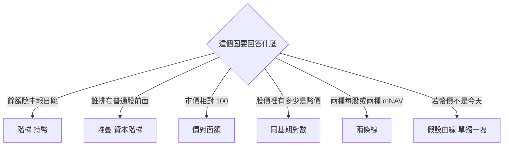

# 圖的語法

回到 [設計指南](../DESIGN_GUIDE.md)。圖是函式，不是頁面上的一段 SVG。現有實作在 `app/src/charts/`。座標骨架在 `lib/frame.ts`：內部寬 880、左 56、右 16，CSS 再把 SVG 縮到欄寬。

選圖只看問題，不看頁面叫什麼名字。

---

## 1. 筆畫

同一張圖裡，筆畫表示資料的方法，顏色表示是哪一檔或哪一個指標。兩件事不互相替代。

| method | 筆畫 | 現況 |
|---|---|---|
| `observed`、`step` | 實線，寬 1.6–1.8 | 週持幣階梯已是實線，觀測日有點 |
| `carry` | 與上一筆相同的實線，觀測日加一顆刻度。圖例寫沿用 | 日頻面板沒有這顆刻度 |
| `linear` | 虛線 `4,3`，透明度約 0.85。圖例寫「兩次申報之間的直線，不是每日買進」 | 日頻持幣現在是實線斜坡，看不出是補的 |
| `spliced` | 虛線，並在定義切換的那一天畫一條 `--warn` 直標 | Reserve 與 Cash 的接線沒有標 |
| `reconstructed` | 同 `linear`，圖例多「重建」二字 | 優先股股數沒有分開畫 |
| 參考序列 | 虛線 `3,3`，透明度約 0.4，色 `--btc` | 每股圖上的幣價、比特幣河流上的幣價已是這樣 |
| `assumed` | 不畫進歷史圖。單獨一塊，線色 `--ink-3`，標題帶「假設」 | 定價頁的滑桿曲線是單獨一塊，但預設值沒有標成假設 |

堆疊面積用實心、透明度 0.9 左右。普通股那一層 `--equity` 透明度約 0.5–0.62，讓底下的求償權還讀得到。溢價與折價的夾層現在用 `--good` / `--bad` 透明度 0.35，只在美元河流圖。那個夾層比較的是堆疊頂與比特幣總市值，圖例要寫出來，不能只靠綠紅。

軸文字 9–10.5px，色 `--ink-3` 或該序列的顏色，等寬只用於日期。不要在圖內寫完整解釋；解釋放圖下的 `.figcaption`（0.83rem，`--ink-3`，最寬 80ch）。

圖例是 `.legend` 加 9px 色塊，順序跟堆疊從下到上一致：可轉債、STRF、STRC、STRK、STRD、STRE、普通股。沒有價格的 STRE 在價對面額圖留空，不把面額畫成價。

---

## 2. 種類

每一種都是以後要留在 `app/src/charts/` 的一個函式。頁面傳指標與區間，不傳顏色。

### 階梯 `holdingsStep`

何時：持幣、任何「只在申報日改變」的存量。

現況：`drawAccumulation`。資料是 `weekly.json`，不是 `daily.held`。階梯只在有 `holdings` 的週跳躍，融資來源的長條用 `FUNDING_COLOR`。賣幣 `--bad`，8-K 未指名 `--ink-3`。

規格：X 是日期，不是日頻索引。Y 是顆。觀測日可點回該週的 EDGAR（`a.src`）。不把直線補點叠在同一條階梯上。若要對照直線，那是第二條序列，筆畫走上一節的 `linear`。

### 堆疊 `capitalStack`

何時：誰的求償權在普通股前面。

現況：`drawRiverUsd`（美元）與 `drawRiverBtc`（顆或每股 sats）。層序是可轉債 `--convert`，然後 STRF 到 STRE 的 `--c1`…`--c5`，最上普通股 `--equity`。比特幣總市值或幣價是虛線參考。

規格：堆疊的頂等於該日的淨求償權加上普通股，或在比特幣計價時等於持幣。現金從可轉債層往上扣，不另畫一條「毛額」。圖下用一句話寫減項，不在圖裡再標一個未扣現金的合計。美元與顆是兩張圖，不在一張圖上換單位。

### 價對面額 `priceToPar`

何時：優先股市價相對 stated amount 100。

現況：閘門卡只有 STRC 的一個讀數（面額、市價、差距、開或關）。時間序還沒有五條線。

規格：Y 是市價，或是相對 100 的百分比，全圖統一一種。STRC 實線寬 1.8，其餘實線寬 1。STRE 不畫。100 是一條 `--line-2` 的水平參考，標「面額」。低於面額 5% 的「開／關」是顯示用的門檻，圖註要寫「不是條款」，總覽已有這句。

### 同基期對數 `indexedLog`

何時：股價漲跌裡有多少跟著比特幣。

現況：`drawPrice`。MSTR 用 `--senti`，BTC 用 `--btc`，同基期。

規格：只放在「在拆股價」的頁，不作為進站第一張圖。軸標寫「同基期」，不寫絕對價格在對數軸上冒充報酬。游標的標籤給出當日絕對價格（`usd` / `usd0`），讓讀者不用心算。

### 兩條線 `pairedLines`

何時：兩個有名字的口徑要並排。basic 與 CEBE mNAV（`drawMnav`），帳面每股與實得每股（`drawPerShare`）。

現況：CEBE／實得用 `--equity` 實線 1.8；basic／帳面用 `--c3` 實線 1.5。後者要改成 `--ink-2`，見視覺系統。

規格：圖例寫全名「basic mNAV」「CEBE mNAV」，不寫「mNAV」。每股圖的右軸或虛線參考是比特幣價格，不跟 sats 共用一個刻度卻不標。

### 假設曲線 `assumedCurve`

何時：問題是「若幣價或槓桿不是今天」。

現況：`charts/leverage.ts`。最新一天當基準，滑桿改變比特幣價格，曲線是實得每股。漸近線是沒有求償權的帳面每股。

規格：這塊放在歷史圖的下面，標題含「假設」。預設滑桿若不是當天讀數（例如槓桿下限 1.30x，而當天放大是另一個數），數字旁用假設徽章。輸出與歷史讀數不用同一個磁貼樣式。黃金檔仍是 `app/test/scenario.test.ts`。

### 階段條 `phaseStrip`

何時：讓人看出現在在哪一段、每段多長。

現況：`drawEraStrip`。色塊依下標循環，寬度大於 62 使用者單位才放標題，所以短的「壓力測試」在圖上沒有名字。底下一條 `--equity` 是實得每股。

規格：色塊改中性色階。每一段的名字列在軸的下方，不靠寬度決定誰叫得出來。點色塊跳到該則。進行中的那段透明度更高（現在是 0.85 對 0.55），並在旁邊用 `.badge.live` 寫「進行中」。

---

## 3. 游標

探索器（`components/explorer.ts`）讓同一頁的圖共用 `state.idx`。拖任何一張、拖底部滑桿、或按左右方向鍵，都改同一天。十字線標出當天日期與各序列的格式化值。

燈箱的範圍（`lib/range.ts`）是「以最新一天為終點往回抓」：全部、兩年、一年、六個月、三個月、一個月。右緣始終是資料的最後一天。

契約：

- 進入一個把磁貼稱為「今天」的頁，游標先落在最後一天。現況是換頁不重置（`state.ts`），所以磁貼可以是 2026-10-01，圖卻停在讀者上次拖到的 2025-02-10。
- 頁首的日期就是游標那天。磁貼若固定顯示最後一天，圖的標題要寫「圖上這一天」，不能跟磁貼搶「今天」這個詞。
- 離開頁面必須卸下訂閱。路由器已經要求 teardown，否則舊圖會繼續跟著游標畫。

觸控：`.scrubbable` 設 `touch-action: none`，避免拖圖時頁面跟著捲。窄螢幕仍要能捲頁，所以只有圖的命中區吃掉觸控，不是整頁。

---

## 4. 圖不負責的事

圖不重新定義求償權，不把兩種現金接成一條卻不標，不在圖例裡發明詞彙表沒有的名字。放大燈箱只是同一張圖的更大座標，範圍按鈕不換指標。
