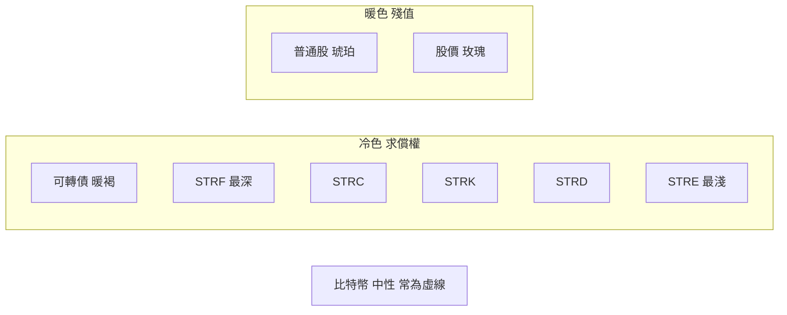

# 視覺系統

回到 [設計指南](../DESIGN_GUIDE.md)。數值摘自 `app/src/styles/tokens.css` 與 `app.css`，格式摘自 `app/src/lib/format.ts`。

`tokens.css` 開頭已經寫了編碼，不是裝飾：可轉債用暖褐，因為它在優先股之上；五檔優先股同一色系、清償順位由深到淺；普通股用琥珀，跟求償權的冷色分開；比特幣用中性色當基準線。這一頁把這段話收成可以指認的 token。

---

## 1. 證券色

契約：全站一張表。堆疊圖、融資來源長條、圖例、閘門列，同一檔證券同一個顏色。

| 證券 | 現在的 token | 淺色 | 深色 | 契約上的名字 |
|---|---|---|---|---|
| 可轉債 | `--convert` | `#6B5443` | `#9C7C5F` | `--inst-convert` |
| STRF | `--c1` | `#0E3B57` | `#1D5F82` | `--inst-strf` |
| STRC | `--c2` | `#1A6E93` | `#2C8CB4` | `--inst-strc` |
| STRK | `--c3` | `#2E9BB8` | `#4BB0CB` | `--inst-strk` |
| STRD | `--c4` | `#6BC2D4` | `#83CEDC` | `--inst-strd` |
| STRE | `--c5` | `#AEDDE6` | `#B8E6ED` | `--inst-stre` |
| 普通股殘值 | `--equity` | `#C97A22` | `#E9A755` | 保持 `--equity` |
| 比特幣 | `--btc` | `#26333A` | `#C7D1D6` | 保持 `--btc` |
| MSTR 股價 | `--senti` | `#B23E58` | `#DE8296` | 建議改叫 `--price-mstr`，色值先沿用 |

深淺是清償順位：STRF 最深，STRE 最淺。可轉債不在這條漸層上。`charts/timeseries.ts` 的 `USD_LAYERS` 與 `charts/riverBtc.ts` 的 `LAYERS`、`charts/accumulation.ts` 的 `FUNDING_COLOR` 已經按這張表塗優先股與普通股。

`--c6`（淺色 `#D5EEF2`，深色 `#DAF2F6`）沒有證券。不要把它派給第六檔。沒有第六檔之前，圖上不使用它。

### 現在撞色的地方

這些是契約要拆開的，程式還沒拆：

| 現況 | 問題 |
|---|---|
| basic mNAV 與帳面每股用 `--c3` | `--c3` 是 STRK。兩條「對照線」看起來像第三檔優先股。契約：對照線用 `--ink-2`，直到有專用的 `--series-basic` |
| `--senti` 與 `--bad` 淺色都是 `#B23E58`，深色都是 `#DE8296` | 股價線與「下跌」是同一個色。契約：股價保持現在的玫瑰色；`--bad` 改成更深的一階（淺色建議 `#8E2F3A`，深色建議 `#E07A78`）。在改 token 之前，不要用 `--bad` 畫股價，也不要用 `--senti` 畫負數 |
| 階段色 `ERA_FILL = [--c3, --c1, --bad, --good]`，依陣列下標循環 | 階段不是證券，也不該借 STRK / STRF 的顏色。契約：階段用一條中性色階（`--surface-2` 到 `--ink-3`），好壞只放在階段卡片裡的數字（已有 `.up` / `.down`），不放在時間軸色塊的色相 |
| 實得每股與普通股殘值都用 `--equity` | 這一個可以留。實得每股就是普通股拿到的那一部分，色相一致是編碼，不是撞色 |

可轉債在冷色群裡仍用暖褐，跟優先股漸層分開。這是 `tokens.css` 的原意。

---

## 2. 其餘顏色

淺色紙面是偏綠的灰，不是純白。深色由 `prefers-color-scheme: dark` 與 `data-theme="dark"` 兩段**逐字重複**的變數組成。主題按鈕寫進 `localStorage` 的 `mstr-theme`。契約：深色 token 只寫一處，兩種啟動方式共用。

| Token | 淺色 | 深色 | 用在 |
|---|---|---|---|
| `--paper` | `#F4F6F4` | `#0C1216` | 頁面底 |
| `--surface` | `#FFFFFF` | `#141C21` | 卡片、表、圖的底 |
| `--surface-2` | `#EDF0EE` | `#1C262C` | 公式底、次要塊 |
| `--ink` | `#141B1F` | `#EBECE7` | 正文 |
| `--ink-2` | `#46545B` | `#A3B3BA` | 導語、說明 |
| `--ink-3` | `#78868D` | `#71808A` | 軸、註、眉題 |
| `--line` | `#DCE2E0` | `#222E34` | 分隔、卡片框 |
| `--line-2` | `#C2CCC9` | `#33434C` | 表頭底線、滑軌 |
| `--equity-soft` | `#F6E4CD` | `#3D2E19` | 進行中徽章的底 |
| `--senti-soft` | `#F7DCE2` | `#3D242B` | 現在的「長距離」徽章底 |
| `--good` | `#2C7A55` | `#5FAA82` | 上升、驗證通過 |
| `--warn` | `#A8720F` | `#D9A93F` | 邊界、講義的「邊界」塊 |
| `--bad` | 見上一節 | 見上一節 | 下降。不拿來畫證券 |

漲跌只表示期初到期末的方向：`.up` 用 `--good`，`.down` 用 `--bad`，`.flat` 用 `--ink`。不表示這筆操作好或壞。操作是否加分用 `.tool-badge.good` / `.bad`，那是代數判準的結果，標籤寫「加分／減分」，不寫「正確」。

連結回 EDGAR 用 `a.src`：繼承文字色，虛線底線，避免整表變成一種連結藍。沒有一支「品牌藍」。

---

## 3. 字

| 角色 | 現在的設定 |
|---|---|
| 正文 | `--sans`：`system-ui`、`PingFang TC`、`Microsoft JhengHei`。16px，行高 1.72 |
| 標題、站名、探索器上的日期 | `--serif`：`Iowan Old Style`、`Georgia`、`Songti TC`、`Noto Serif CJK TC`。字重 600 |
| 數字、眉題、徽章、表頭 | `--mono`。數字一律 `font-variant-numeric: tabular-nums` |
| h1 | `clamp(1.9rem, 4vw, 2.7rem)` |
| h2 | `clamp(1.4rem, 2.7vw, 1.85rem)` |
| 眉題 `.eyebrow` | 0.68rem，字距 0.16em，大寫。中文不受大寫影響，字距仍留著，讓眉題跟正文分開 |
| 導語 `.lede` | 1.02rem，`--ink-2`，最寬 70ch |
| 磁貼的數 `.tile .v` | 1.32rem |
| 恆等式結果 `.eq-term.result .eq-val` | 1.42rem，`--equity` |

KaTeX 覆寫在 `app.css` 末段：公式顏色跟 `--ink`，顯示公式橫向可捲。中文用 `\text{}`。講義與儀表板都走這一套，不另嵌圖片公式。

---

## 4. 間距與格子

內容寬 1120px（`.wrap`），左右 24px。頂列高 56px，黏在視窗上，底有 1px `--line`，背景是紙色混 12% 透明再模糊。

主區上 40px、下 90px。頁首 `.page-head` 下緣 28px。

| 區塊 | 規則 |
|---|---|
| 卡片 | 底 `--surface`，框 `--line`，圓角 **4px**，內距 22px 24px |
| 兩欄 | `minmax(320px, 1fr)`，間距 20px |
| 三欄磁貼 | `minmax(200px, 1fr)`，間距 14px |
| 磁貼 | 內距 15px 16px。左邊框只在要強調時加 3px，色用證券色或 `--equity`，不另選 |
| 註 `.note` | 左 2px `--line-2`。`.note.key` 改 `--equity`，`.note.warn` 改 `--warn` |
| 表 | 字 0.88rem。表頭 0.68rem、大寫、黏在捲動區頂。數字欄 `.n` 靠右、等寬 |
| 圖例 | 9px 圓角 2px 的色塊，字 0.78rem |

圓角的漂移：徽章與標籤是 20px 膠囊；燈箱與講義的「怎麼驗」是 6px。契約：區塊用 4px，只有徽章與標籤用膠囊。6px 的兩處下次碰到時收成 4px。

子導覽黏在頂列下，`top: var(--topbar-h, 52px)`。後備 52px 與頂列實際的 56px 不一致。高度應由 `main.ts` 量到的 `--topbar-h` 決定，後備改成 56px。

窄螢幕：讀數格 780px 以下 3 欄、480px 以下 2 欄。公式並排在 720px 以下改成一欄。頂列導覽現在是橫向捲動且藏起捲軸（`.nav { overflow-x: auto; scrollbar-width: none }`），390px 時看得到的項目不到一半。契約：到達放不下全部頂層頁的寬度時，改成一顆按鈕展開全部頁名，不靠使用者發現還能橫滑。圖表本身維持 `svg { max-width: 100% }`，寬表放進 `.scroller`。

動效：進頁 0.22s 的淡入。`prefers-reduced-motion: reduce` 時關掉。

---

## 5. 數字怎麼寫

只透過 `lib/format.ts`。空值是 `—`（`bn`、`mn`、`mult`、`btc` 已如此），不是 0，也不是空白。

| 函式 | 形狀 | 例 |
|---|---|---|
| `usd` | `$` ＋千分位＋預設 2 位 | `$160.50` |
| `usd0` | 四捨五入到元 | `$84,880` |
| `bn` | 已是「十億」的數，2 位＋ `B` | `$14.76B` |
| `mn` | 已是「百萬」的數，0 位＋ `M` | `$227M` |
| `mult` | 2 位＋ `x` | `1.17x` |
| `pct` | 傳入的是比率，顯示乘 100，預設 1 位 | `20.5%` |
| `sats` | 四捨五入＋ ` sats` | `162,003 sats` |
| `btc` | 顆，預設 0 位小數 | `847,666` |
| `signed` | 正數帶 `+` | `+1.1%` 由文章釘自己格式化 |

百分數的內值是比率：`pct(0.205)` 得到 `20.5%`。文章釘裡 `unit === "%"` 時，`posts/detail.ts` 把數值當**已經是百分數**再 `toFixed(1)`。兩套差 100 倍。契約：百分數進格式化之前是比率，釘的 `unit` 若是 `%`，存的 `then` 也是比率，顯示一律走 `pct`。

金額在指標層是美元（見資料模型）。`bn` 假設手上已經是十億，這是發布投影的縮放。頁面不再自己除 `1e9`。

日期在畫面上用 `YYYY-MM-DD`。區間寫 `2026-06-26 → 2026-10-01`，進行中的右端寫「進行中」，階段條已是這個句式。

眉題與表頭的英文大寫不要拿來改中文標籤。中文標籤保持詞彙表的寫法。

---

## 6. 徽章

現有元件是 `.badge`，等寬 0.7rem，膠囊，左側 6px 圓點。

| class | 現在的意思 | 契約 |
|---|---|---|
| `.live` | 底 `--equity-soft`，字 `--equity`。探索器拿來表示「近」 | `observed` 與 `step`：申報日就是這個數的日子 |
| `.near` | 底 `--good`，字是表面色 | 退役。距離不該是一種綠 |
| `.far` | 底 `--senti-soft`，字 `--senti` | 退役。那是把最大的 `days_to_anchor` 畫成危險 |
| （尚無） | | `carry`：底 `--surface-2`，字 `--ink-2`，文案「沿用 {asOf}」 |
| （尚無） | | `linear`：底 `--senti-soft`，字 `--ink`，文案「直線，不是每日買進」 |
| （尚無） | | `spliced` / `reconstructed`：左框 `--warn`，文案寫出接線日或「重建」 |
| （尚無） | | `assumed`：虛線框，文案「假設」 |

一顆徽章只描述一個欄位。頁首可以並列多顆（價格日、持幣申報日、債務沿用日、讀者的今天），不把它們收成一顆。

`.tool-badge` 是另一種膠囊，給工具的加分／減分／中性，不拿來表示新鮮度。
